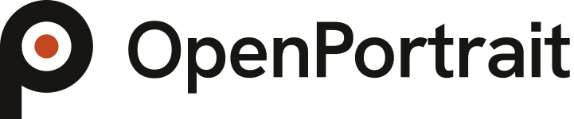

<p align="center">
  <picture>
    <source media="(prefers-color-scheme: dark)" srcset="docs/brand/openportrait-logo-dark.svg">
    
  </picture>
</p>

<p align="center">An open-source, self-hosted studio CRM for photographers. Runs as a Docker container and an Unraid app.</p>

<p align="center"><a href="https://openportrait.app">openportrait.app</a></p>

---

Brand assets (logo, icons, colors) live in [`docs/brand`](docs/brand/README.md).

## What's in it

- **Clients and leads:** one record per client, a lead pipeline, and an inquiry form for your website.
- **Shoots and calendar:** shoot types, a studio calendar, and two-way Google Calendar sync.
- **Booking pages:** clients pick a session and a time from your availability. Special dates, daily limits and deposits are built in, and a confirmed booking can become a shoot automatically.
- **Questionnaires:** send a form by hand, or automatically when a shoot is booked.
- **Contracts and e-signatures:** write templates, have clients sign online, and keep a signed PDF with an audit trail. A booking can require a signed agreement before it is paid.
- **Quotes, invoices and payments:** a price list, deposits and balances, manual payments, PayPal checkout, coupon codes and client credit.
- **Galleries:** photos from your own storage, client galleries with favorites and downloads, and an optional payment lock on downloads.
- **Camera upload:** cameras send photos over SFTP, FTP or FTPS, and SFTP tethering shows a live view while you shoot.
- **Tasks and households:** a to-do list on every shoot with starter checklists, and households that group the people who share a home or company.
- **Reports:** income, outstanding balances and bookings over time, with CSV export for clients, shoots and invoices.
- **Website builder:** build a static studio website and host it anywhere.
- **Import and export:** bring in clients, shoots and invoices from a CSV or JSON file, and export them back out.
- **Connect your AI:** a built-in MCP server for an AI assistant. It is off until you turn it on, and anything that reaches a client or moves money waits for your approval by default.
- **Extensions:** optional modules that add tools, settings and sidebar pages.

See the [changelog](CHANGELOG.md) for what changed, and the [product spec and roadmap](docs/SPEC.md) for what is planned.

## Guides

| Guide | What it covers |
|---|---|
| [Install with Docker, Compose or Unraid](docs/install-docker.md) | Running the container and the Unraid template |
| [Internet access with Cloudflare Tunnel](docs/cloudflare-tunnel.md) | Reaching your studio from outside your network |
| [Email, inquiry form and booking pages](docs/booking.md) | Outgoing email, the inquiry form, and booking pages |
| [Questionnaires](docs/questionnaires.md) | Building forms and sending them to clients |
| [Contracts and e-signatures](docs/contracts.md) | Templates, signing, and signing before payment |
| [Quotes, invoices and coupons](docs/orders.md) | Price lists, quotes, payments, and coupon codes |
| [Galleries](docs/GALLERIES.md) | Folder ingest, client galleries, and payment locks |
| [Camera upload](docs/camera-upload.md) | Sending photos from the camera over SFTP, FTP or FTPS |
| [Tethering](docs/tethering.md) | Live view while shooting tethered |
| [Google Calendar](docs/google-calendar.md) | Two-way calendar sync |
| [Importing your data](docs/import.md) | Bringing clients, shoots and invoices in from a file |
| [Connect your AI](docs/ai-access.md) | Connecting an AI assistant through MCP, with approvals |
| [Tasks](docs/tasks.md) | Shoot to-do lists and starter checklists |
| [Households](docs/households.md) | Grouping contacts who share a home or company |
| [Website builder](docs/website.md) | Building and hosting a static studio site |
| [Accessibility](docs/accessibility.md) | What is in place and how to report a problem |
| [Releasing](docs/releasing.md) | Maintainer notes for cutting a version |
| [Extensions](docs/extensions.md) | Writing an extension module |

The [product spec and architecture](docs/SPEC.md) describes the design and the roadmap.

## Install

- [Docker, Docker Compose and Unraid](docs/install-docker.md)
- [Reaching it from the internet with Cloudflare Tunnel](docs/cloudflare-tunnel.md)

```sh
mkdir -p appdata galleries incoming cache
docker run -d --name openportrait --restart unless-stopped \
  --cap-drop ALL --cap-add CHOWN --cap-add SETUID --cap-add SETGID --cap-add FOWNER \
  --security-opt no-new-privileges \
  --read-only --tmpfs /tmp:rw,noexec,nosuid,size=256m \
  --pids-limit 512 --memory 2g \
  -p 8080:8080 \
  -e PUID="$(id -u)" -e PGID="$(id -g)" -e TZ=America/New_York \
  -v "$PWD/appdata":/config \
  -v "$PWD/galleries":/galleries \
  -v "$PWD/incoming":/incoming \
  -v "$PWD/cache":/cache \
  ghcr.io/e2346437/openportrait:0.2.0-beta.1
```

Use the newest version number from the [Releases page](https://github.com/e2346437/openportrait/releases) instead of `0.2.0-beta.1`. The tag is pinned on purpose: you choose when to update, and `latest` can change under you. The extra flags drop privileges the app does not need; [why and what each does](docs/install-docker.md#docker-run).

Then open `http://localhost:8080` and follow the setup screen.

## Development

You need Node 22 and pnpm 10 (`corepack enable` sets up pnpm).

```sh
pnpm install
pnpm build          # shared packages first, then the server and the web app
pnpm dev            # server on :8080 and the web app on :5173 with hot reload
pnpm test           # unit and API tests
pnpm typecheck
```

`pnpm dev` keeps its data in `./data`. Delete that folder to start over from the setup screen.

| Folder | What's in it |
|---|---|
| `apps/server` | Fastify API, background jobs, the cloudflared supervisor, and the `openportrait` maintenance CLI |
| `apps/web` | The React app (staff pages live under `/studio`) |
| `packages/db` | Drizzle schema (`src/schema/<area>.ts`) and SQL migrations |
| `packages/jobs` | The SQLite-backed job queue (`defineJob`, `enqueue`) |
| `packages/config` | Environment variables and folder paths |
| `packages/ui` | Design tokens, base styles and shared components |
| `docker`, `Dockerfile` | The image: entrypoint (PUID/PGID/UMASK) and bundled cloudflared |
| `unraid` | The Unraid Community Applications template |

After changing the schema, run `pnpm db:generate` to write a new migration.

## Security

Please report vulnerabilities privately; see [SECURITY.md](SECURITY.md). The [security documentation](security/) covers the threat model, hardening and the release gate.

## License

OpenPortrait is free software under the [GNU AGPL-3.0](LICENSE). See [CONTRIBUTING.md](CONTRIBUTING.md) to get involved.
