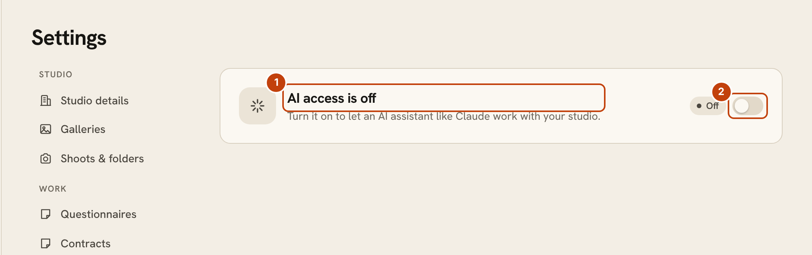
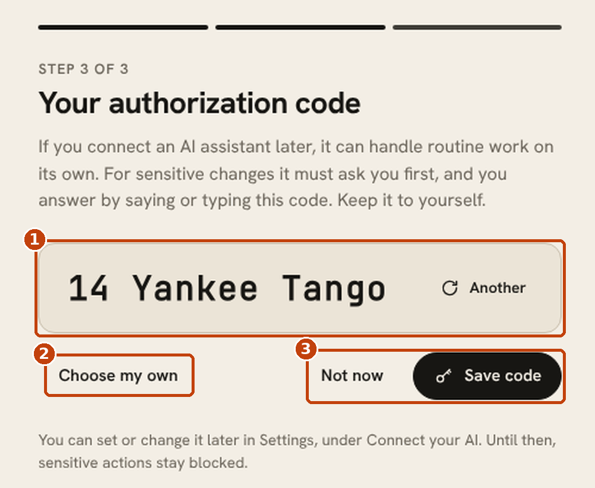
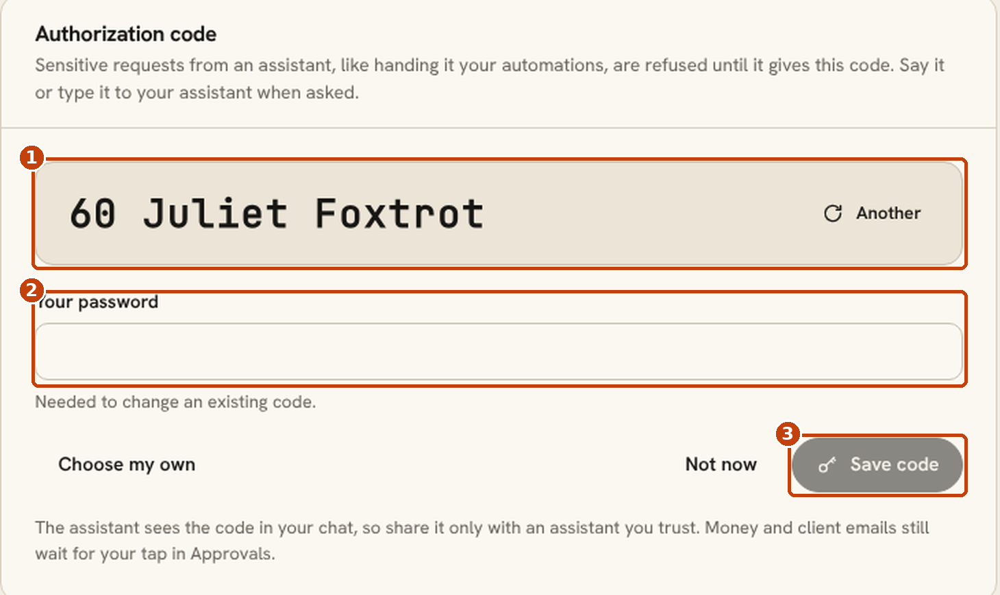

# Connect your AI

OpenPortrait has a built-in MCP (Model Context Protocol) server. Connect an AI assistant such as Claude, ChatGPT, Claude Code or Cursor, and it can look up clients, shoots, bookings, quotes and galleries, and help you run the studio.

Access is off until you turn it on, and it is built to keep you in charge.

## Turn it on

Go to **Settings > Connect your AI** (owner only) and switch it on. Remote assistants need a working [Cloudflare Tunnel](cloudflare-tunnel.md) or a URL they can reach. The page shows your MCP address with a copy button and the steps for each assistant.

- **Claude and ChatGPT** (custom connectors): paste the address into the connector. The assistant opens an OpenPortrait sign-in and consent page, and you approve the access it asks for.
- **Claude Code, Cursor and scripts:** create an access token on the same page. The token is shown once, so copy it then. It is stored only as a hash.

1. The status line says whether AI access is on or off.
2. The switch is the only control that turns access on. Turning it off stops every connected assistant at once.

The page confirms the connection the first time the assistant calls OpenPortrait. **Test connection** runs a harmless read.

## Choose what it can do

Each connection has an access level:

| Level | What the assistant can do |
|---|---|
| **Read** | Look at contacts, leads, shoots, the calendar, orders and galleries |
| **Assist** | Read, plus make internal drafts such as notes, tasks and draft quotes. It can also ask to send, publish or record money, but every such request waits for your approval |
| **Full** | The same tools as Assist. Today the two differ only in label; Full is reserved for per-action auto-approval later. Anything that reaches a client or money still asks you first |

Use the per-area switches to limit a connection further, for example to galleries only.

## Approvals

Anything that reaches a client or touches money goes to **Approvals** first. That includes sending an email, sending a quote or contract, publishing a gallery, confirming a booking, sending a questionnaire, recording a payment, or issuing a credit. You see the exact content and can approve, edit or decline it. Pending items expire after 7 days. Approving checks the connection again at that moment: if it was revoked, expired, lost access to that area or was cut back to read-only after the request was made, the action does not run. Revoking a connection cancels everything it had waiting.

Auto-approval is a setting you can turn on for each kind of action. It is off by default, and new kinds of action always start in approval.

Client-written text, such as inquiry messages and questionnaire answers, is passed to the assistant as untrusted content. Assistants are told not to follow instructions found in it, and the approval step still applies.

## Authorization code for sensitive actions

Some actions are too important to trust to an assistant on its own, such as switching the studio's automation mode. These **sensitive** actions only run when the assistant includes your **authorization code** with the request. Without a code, they stay blocked.

Money and client emails are different. They still wait in **Approvals** for your tap, with or without a code.

### Set your code

The setup wizard has a third step, **Your authorization code**. It suggests a random code made of a number and two words, such as `14 Yankee Tango`.

1. The suggested code. Choose **Another** for a different one.
2. **Choose my own** lets you type your own, at least 6 characters.
3. **Not now** skips it. **Save code** keeps it.

You can set or change it any time under **Settings > Connect your AI > Authorization code**.

1. Your code. **Another** suggests a new one.
2. **Your password.** Changing an existing code needs your account password.
3. **Save code** saves it.

### Using it

When an assistant needs a sensitive action, it asks you for the code. Say or type it in the chat. Pick something you can remember. There is nothing to look up later, because the code is never shown again after you set it.

### What it protects, and what it doesn't

- **It guards against injected text.** If a client's message or a web page tells your assistant to change something sensitive, the assistant can't do it without the code you hold.
- **It does not guard against a compromised AI account.** The code passes through the chat, so anyone who can read your conversation can see it. Share it only with assistants you trust, and change it if you think it was exposed.
- **There is no emailed reset.** If you forget it, set a new one in Settings with your password.
- **Wrong guesses lock the connection.** Five wrong tries in 15 minutes lock that connection for an hour.
- **It is stored safely.** The code is stored as a hash, and is never returned or written to logs.

Free, with no extra cost.

## Limits and records

- Each connection is rate limited, and client emails sent through an assistant are capped per day.
- An assistant can only email people who are already your contacts.
- Every call is written to the activity log with the connection, the tool, the result, and who approved it. **Settings > Connect your AI > Activity** shows it as a timeline.
- No tool returns passwords, tokens or the tunnel secret, and no tool can change access settings.

## Give it a good brief

A connected assistant works best when it knows what OpenPortrait is and how approvals work. Paste the [starter prompt](ai-prompt.md) into your assistant's instructions.

## Stop it

**Pause all AI access** at the top of the page stops every connection at once. Revoke a single connection from its row, and its token stops working.
