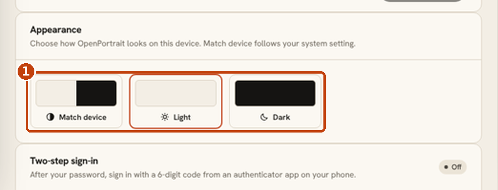
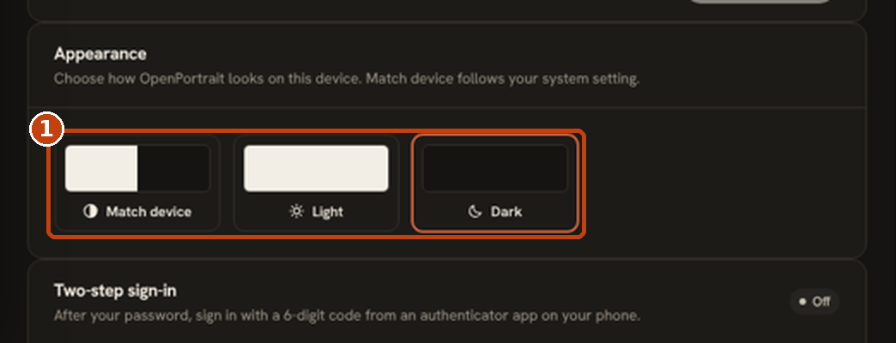

# Light, dark or match your device

OpenPortrait can use a light theme, a dark theme, or follow your device. The choice is yours alone and is remembered in the browser you make it in.

## Choose a theme

There are three ways to change it. All three do the same thing.

- **Sidebar.** The toggle in the sidebar footer cycles through Match device, Light and Dark.
- **Sign-in and setup screens.** A toggle in the corner works before you sign in.
- **Settings > Your account > Appearance.** A picker shows a preview of each option.

1. **Appearance.** Pick **Match device**, **Light** or **Dark**. The selected option is outlined.

## The three options

| Option | What it does | Use it when |
|---|---|---|
| **Match device** (default) | Follows your phone or computer's light and dark setting, and changes with it, such as at sunset | You want it to just work |
| **Light** | Always light | You edit in a bright room, or find dark themes harder to read |
| **Dark** | Always dark | You work in a dim room or tethered on a shoot, where a bright screen is distracting |

Free, with no extra cost.

## Good to know

- **Saved per browser, not per account.** Your phone and your desktop can use different themes. A new browser starts on Match device.
- **Client galleries are not affected.** Each gallery has its own theme, set in the gallery's settings. See [Client galleries](galleries-guide.md).
- **Emails stay light**, so they look the same in every mail app.
