# Camera upload away from home: a travel router

Your camera can send photos to OpenPortrait from a venue, a hotel or a phone hotspot. The camera joins a small travel router that you carry, and the router opens a private connection to your home network. The camera then reaches the server at the same address it uses at home.

This page covers two ways for the router to get home: **WireGuard** (the main route) and **Tailscale** (an optional second route). For the server, protocols and camera menus, see [Camera upload](camera-upload.md).

!!! warning "Tested at home only so far"
    Every step on this page was carried out on a real travel router, and the tunnel connected. The full trip (router on a phone hotspot or venue Wi-Fi, a camera upload arriving in Incoming) has **not been tested yet**. Steps that depend on it are marked *untested*. Do your own test away from home before you rely on this at a shoot.

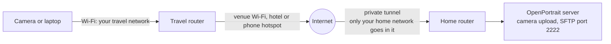

## Choose a route

| | WireGuard (main) | Tailscale (optional) | Forward the SFTP port instead |
|---|---|---|---|
| **How it works** | The travel router dials your home on one UDP port. | Both ends join your Tailscale network, and a home device shares the home network. | The camera connects straight to a port on your home router. |
| **Extra hardware** | A travel router | A travel router | None |
| **Open port at home** | One UDP port (51820). WireGuard ignores anything without the right key. | None | The SFTP port |
| **Depends on** | Your home address staying known (use dynamic DNS) | A Tailscale account and its service | Your home address staying known |
| **Cost** | The router, roughly $100 to $150. No fees. | The router. Tailscale has a free plan for personal use; check its current terms. | No hardware cost |
| **Good for** | The most private route with nothing else to sign up for | Homes where you can't forward a port, or a backup for the WireGuard route | Shoots where carrying a router is not practical |
| **Watch out** | The tunnel stops if your home address changes and you have no dynamic DNS name. | Sign-in keys expire unless you turn expiry off. A home device must stay on to share the network. | The camera password travels to a port the whole internet can reach. Use SFTP only, never plain FTP. |

You can set up both tunnel routes on the same router and switch between them.

## What you need

- A travel router that can be a WireGuard client. These steps were written on a GL.iNet router with firmware 4.10; other brands have the same settings under other names.
- A server running OpenPortrait. The home steps below use Unraid's built-in **VPN Manager**, which needs no change to the OpenPortrait container. On other systems, run WireGuard on your home router or in a WireGuard container and follow the same shape.
- Access to your home router to forward one port (WireGuard route only).
- Your home network range, for example `192.168.4.0/24`, and the server's address on it, written here as `<studio-ip>`.

Throughout this page and in the screenshots, `Studio Wi-Fi` is the network the travel router broadcasts, `192.168.4.0/24` is the example home network and `<studio-ip>` is the server. Use your own values. Private details in the screenshots are covered with a REDACTED box.

## 1. Get the travel router ready

1. Connect a laptop to the router and open its admin page (on GL.iNet, `http://192.168.8.1`). Sign in.
2. **Give it internet.** On **Internet**, use **Repeater** to join a Wi-Fi network: your own at home, the venue's on the road. A phone hotspot or a network cable work as well.

    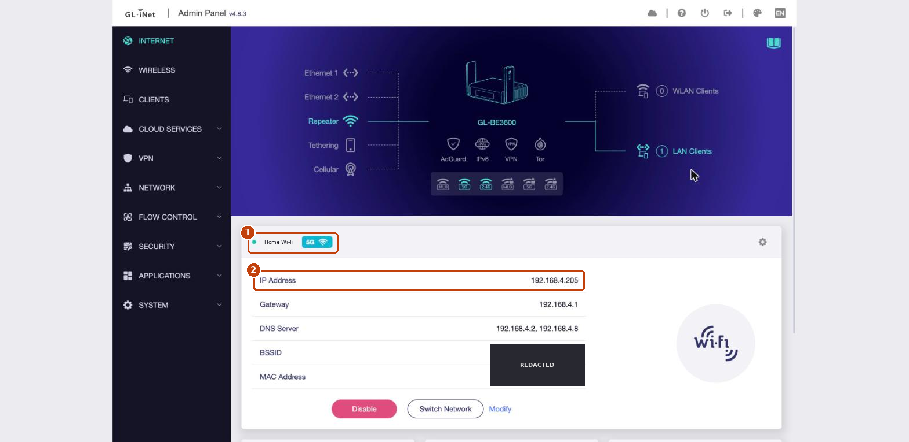

    **1** The network the router joined. **2** The address it was given, which shows it is online.

3. **Update the firmware.** Go to **System > Upgrade**, keep **Keep Settings** on, and install what is offered. The router restarts and you sign in again. Check a second time afterwards, because one update can reveal another.
4. **Name its Wi-Fi.** Under **Wireless**, give the 2.4 GHz and 5 GHz bands the same name (for example `Studio Wi-Fi`) and the same new password. The camera and laptop pick whichever band works.

    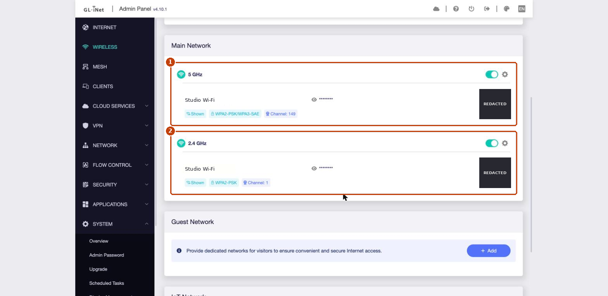

    **1** The 5 GHz band. **2** The 2.4 GHz band, with the same name and password.

If a camera refuses to join, set that band's security to WPA2 only. Some cameras don't support WPA3.

## 2. WireGuard: the home side

These steps use Unraid's VPN Manager.

1. In Unraid, open **Settings > VPN Manager**. On tunnel `wg0`, type a **Local name** and choose **Generate Keypair**. **Local endpoint** fills in with your home's public address and port 51820.

    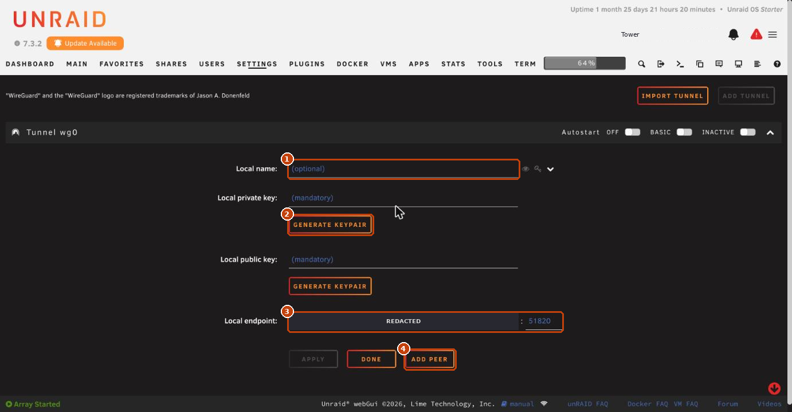

    **1** Local name. **2** Generate Keypair. **3** Local endpoint and port. **4** Add Peer.

2. Choose **Add Peer**. Name it after the router. Set **Peer type of access** to **Remote access to LAN**. Choose **Generate Keypair** for the peer and **Generate Key** for a preshared key, then **Apply**.

    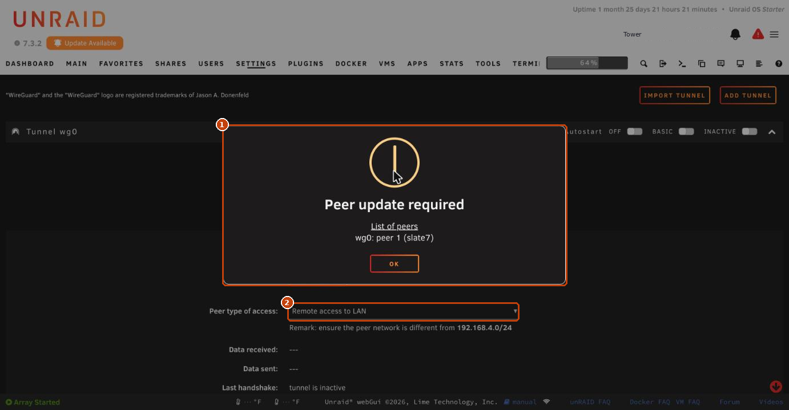

    **1** Unraid says the peer needs its new config. Choose OK. **2** The access type to pick.

3. At the top of the tunnel, switch **Autostart** on and switch the tunnel to **Active**.
4. On your home router, forward **UDP port 51820** to the Unraid server's address. If your home has more than one internet connection, forward it on each.

    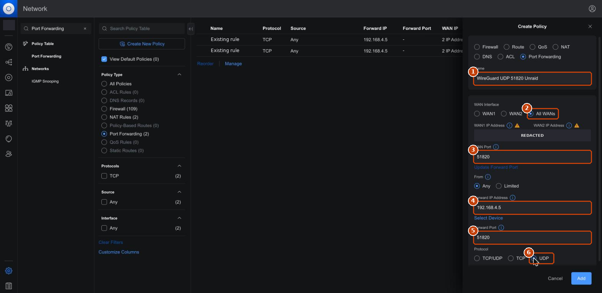

    The form looks different on each brand of router. The values are the same: **1** a name, **2** which internet connection, **3** outside port 51820, **4** the server's address, **5** inside port 51820, **6** UDP.

!!! tip "Use a name, not a number, for the endpoint"
    Most home internet addresses change now and then. If **Local endpoint** holds a raw address, the tunnel stops connecting when it changes. Set up a dynamic DNS name, put it in **Local endpoint**, and then download the peer file. If you change it later, download and import a fresh peer file.

Keep the key fields off screen. Don't screenshot or paste them. If a key is ever shown or shared, generate a new keypair before saving.

## 3. WireGuard: the travel router side

1. In Unraid, on the peer you made, choose the eye icon (**View Peer Config**) and **Download**. You get a zip file. **It contains the router's private key.** Keep it private and delete it once it is imported.
2. On the travel router, open **VPN > VPN Client Profile > WireGuard > Add Manually**. Upload the zip. The router finds one valid configuration and ignores the QR image in the zip. **Apply**.

    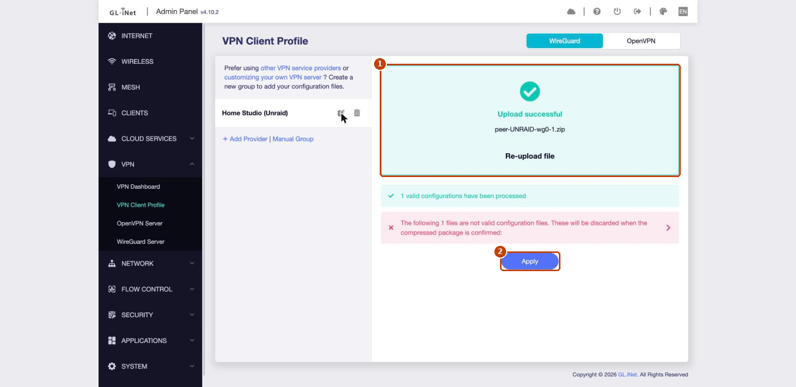

    **1** The upload result. The red line about one invalid file is the QR image and is expected. **2** Apply.

3. Choose **Go to Dashboard**, then in **Add New Tunnel**:
    - **Use:** the profile you just imported.
    - **From:** All Clients.
    - **To:** **Specified Domain / IP List**, with your home network range, for example `192.168.4.0/24`.

    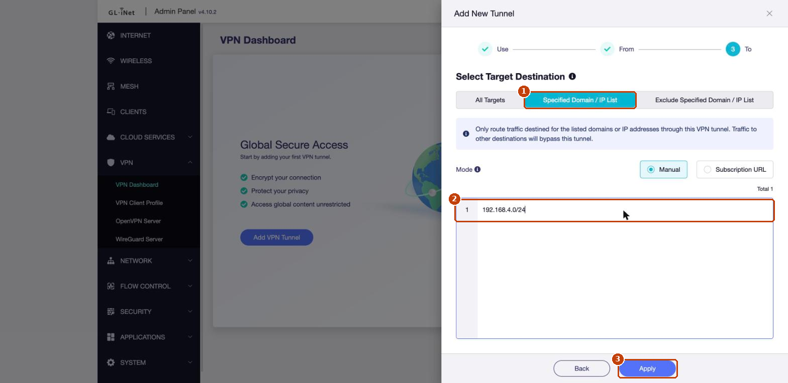

    **1** Specified Domain / IP List. **2** Your home range. **3** Apply.

4. Leave the tunnel's **kill switch** on, with other traffic allowed outside the VPN.
5. On the **VPN Dashboard**, switch the tunnel on. It shows **Connected** with a tunnel address. In Unraid, the peer shows a **Last handshake** time.

    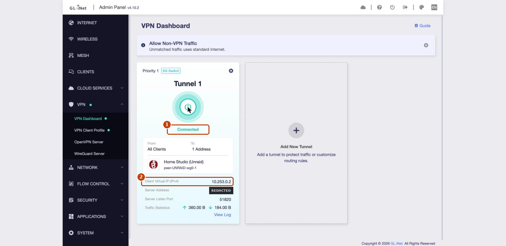

    **1** Connected. **2** The router's address inside the tunnel.

    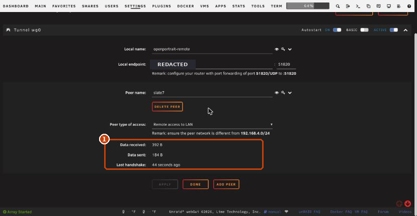

    **1** Data counters and the last handshake time on the home side.

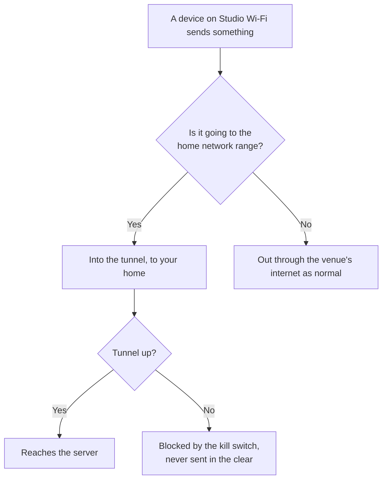

**Why only the home network goes in the tunnel.** An Unraid **Remote access to LAN** peer does not carry general internet traffic. If you route everything through it, the laptop and camera lose the internet. Sending only the home range also keeps browsing fast at the venue.

## 4. Point the camera at the server

Join the camera to `Studio Wi-Fi`. Set its upload server exactly as you would at home: the server's home address (`<studio-ip>`), SFTP port `2222` unless you changed it, and the camera's own login from **Settings > Camera upload**. The steps for the camera's menus are on the [Camera upload](camera-upload.md) page.

On the laptop, the studio opens at its usual home address.

*Untested away from home.* At home the router's internet is already your home network, so a working upload there proves nothing about the tunnel.

## 5. Test it away from home

Do this once before a real shoot, and again after any change at home.

1. Give the travel router internet that is **not** your home network. A phone hotspot is the easiest.
2. Check the tunnel shows **Connected**.
3. On a laptop joined to `Studio Wi-Fi`, open the studio at its home address.
4. Send one photo from the camera and check it arrives in **Incoming**.

If step 3 fails, check the port forward, that the tunnel in Unraid is **Active**, and that the endpoint still matches your home's current public address.

## Optional: Tailscale as a second route

Tailscale gets the router home without an open port and without knowing your home address. A device at home that is always on (a server or a small computer) shares the home network with your Tailscale network, and the travel router joins it.

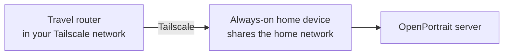

1. **On the travel router:** open **Applications > Tailscale**, switch **Enable** on and **Apply**. Follow the bind link and sign in to your own Tailscale account.
2. **On the home device:** in its Tailscale settings, make sure IP forwarding is on, then add your home range (for example `192.168.4.0/24`) under **Advertised Routes**.
3. **In the Tailscale admin console:** open that machine, review its subnets, tick the home range and save. It moves to **Approved**.

    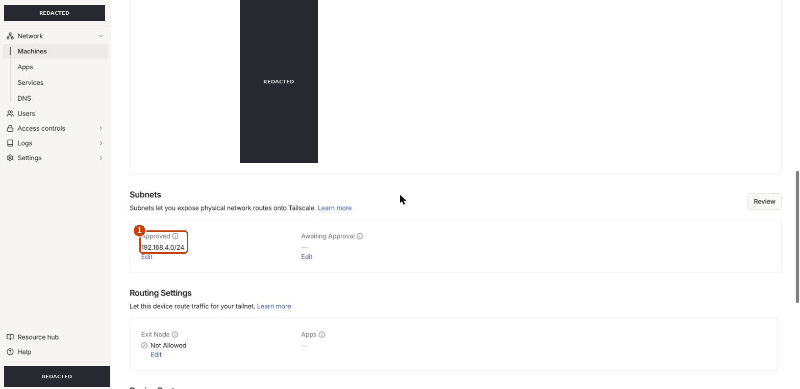

4. **Back on the travel router:** on the Tailscale page, switch **IP Masquerading** on and **Apply**. This lets the camera and laptop behind the router use the shared route and get replies back. Leave the router's own subnet advertising off.

    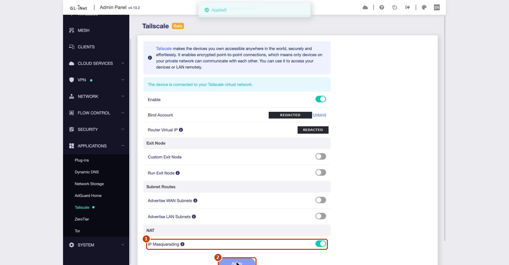

To use Tailscale, switch the WireGuard tunnel off on the router's VPN Dashboard. To go back, switch it on. Tailscale can stay enabled the whole time. Many travel routers let you put this on a physical switch (on GL.iNet, **System > Toggle Button Settings**).

| | Notes |
|---|---|
| **Good for** | Homes behind carrier-grade NAT or where you can't forward a port, and as a fallback if the WireGuard route stops working. |
| **Watch out** | Sign-in keys expire after a few months. Turn off key expiry for the router and the home device in the admin console, or sign in again when asked. The home device must be running. There is no kill switch: if Tailscale drops, the server is simply unreachable. |
| **Cost** | No extra hardware beyond the router. Tailscale's own plan terms apply. |

*Untested away from home*, like the WireGuard route. Run the test in section 5 with the WireGuard tunnel switched off.

## Good to know

- **One open port.** The WireGuard route leaves UDP 51820 open on your home router. WireGuard does not answer packets without a valid key, but it is still an open port. Remove the forward if you stop using this route.
- **Clashing network ranges.** If a venue's network uses the same range as your home, the router can't tell them apart. It is rare. Use a phone hotspot as the router's internet when it happens.
- **Plain FTP.** Inside either tunnel, plain FTP is protected by the tunnel. It is still safer to use SFTP when the camera supports it.
- **The router's screen and buttons.** If your router shows its Wi-Fi password on a screen, set a screen passcode before leaving it out at a venue.
- **What must be running at home.** The OpenPortrait server, with camera upload open (check **Settings > Camera upload**, especially if it is set to open on demand or on a schedule). For Tailscale, the home device that shares the network as well.

## If it does not work

| What you see | What to try |
|---|---|
| Tunnel stays on "Connecting" | Check the port forward (UDP, 51820, to the right server). Check the tunnel is Active in Unraid. Check the endpoint matches your home's current public address. |
| Tunnel connected, studio page won't open | Check the tunnel's **To** list holds your home range. Check you are not at home, where the test proves nothing. |
| Laptop loses the internet when the tunnel is on | The tunnel is set to carry all traffic. Change **To** to your home range only. |
| Camera connects at home but not on the road | Is camera upload open on the server? On-demand and scheduled modes close it. Then check the camera is on the travel router's Wi-Fi, not the venue's. |
| Worked last month, not now | Your home address may have changed. Set up dynamic DNS and import a fresh peer file. For Tailscale, check for an expired key. |
