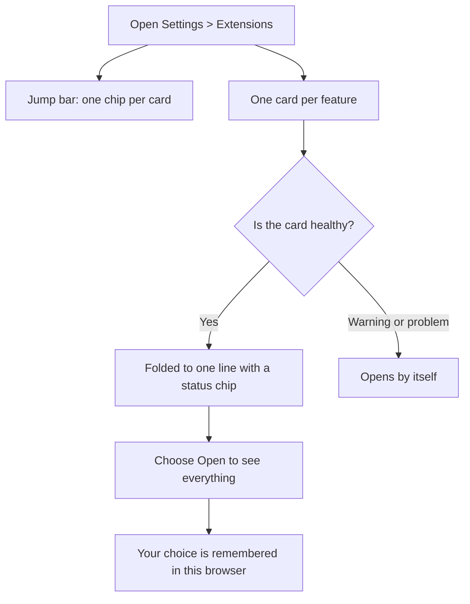

# The Extensions page

Settings > Extensions shows the settings cards that your installed extensions provide. With several extensions installed the page can get long, so cards that are healthy fold down to one line, and a bar at the top jumps to any card.

- **Jump bar.** One chip per card, with a dot showing its state. Choose a chip to go to that card. On a phone the bar scrolls sideways.
- **Folded cards.** A title, a one-line summary and a status chip. Choose **Open** or **Close** to change it. The choice is remembered in this browser only, so another browser or device starts with the default.
- **Cards that need you.** A card whose chip is a warning or a problem opens by itself, so you see what needs attention.
- **Richer cards.** An extension can show a strip of key facts, a list of what it includes with links to other cards, setup steps with your progress, a Copy button for values such as a redirect address, a details section for technical information, and quiet red actions such as Disconnect.

The people panel for managing photographers sits where the extension asked for it among its cards. See [Extensions](extensions.md#crew-panel).

If you write an extension, the card fields are described on the [Extensions](extensions.md) page.
