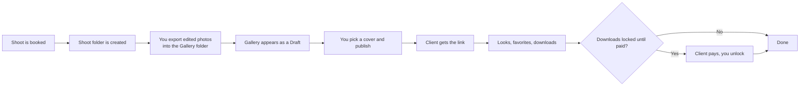
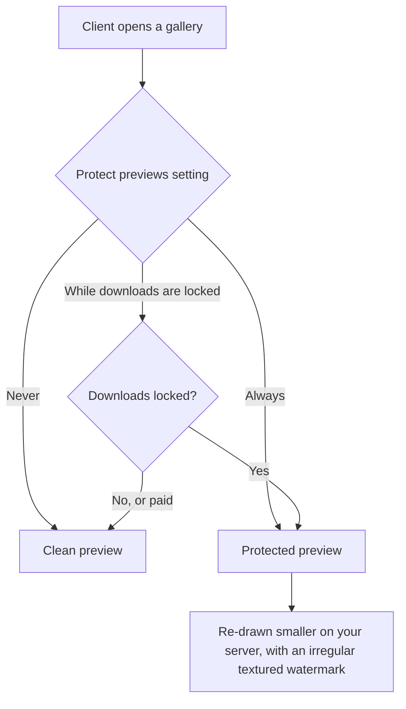
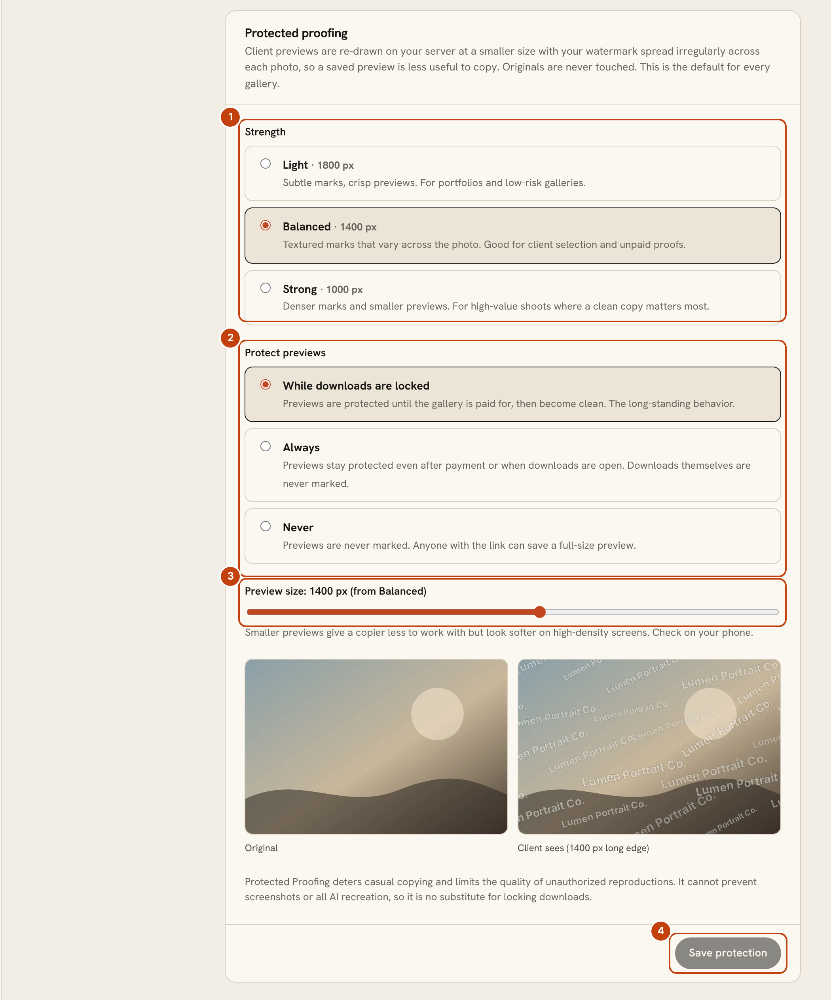
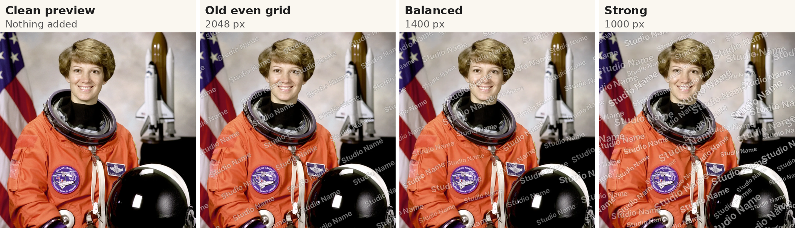
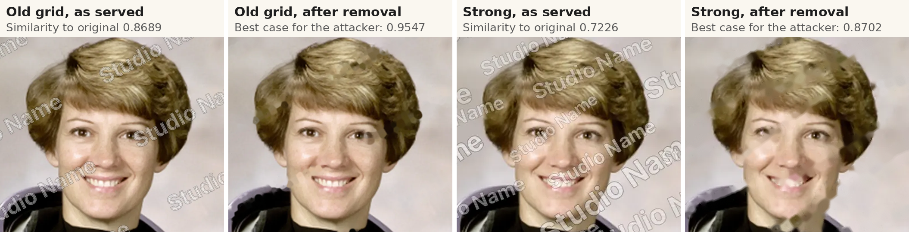
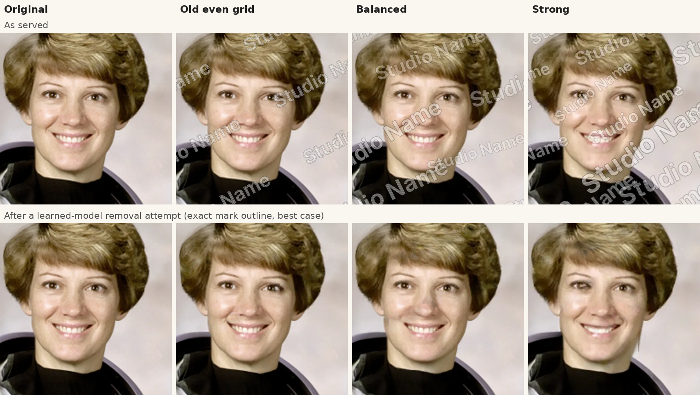
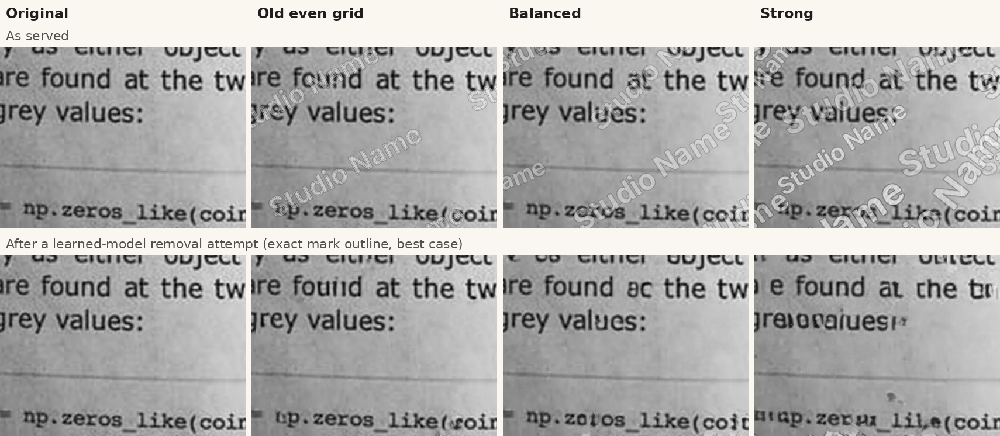

# Client galleries: a step-by-step guide

A gallery is a folder of finished photos that your client opens in a web page: they look, favorite, and download. This page follows one gallery from the camera to the client and says what each choice means. For the full design, see [Galleries: design](GALLERIES.md).

## The path of a gallery

1. **Book the shoot.** OpenPortrait creates a folder for it on your gallery share, such as `2026/2026-11-14 Family - Smith Family/`, with `Gallery/` for finished photos and `Originals/RAW/` for camera files.
2. **Export into `Gallery/`.** From Lightroom, Aftershoot or any editor, export JPEGs there. Exporting straight into the folder needs your computer to reach the server's share, which is not possible if OpenPortrait is hosted remotely (see [Hosting remotely](install-docker.md#known-issue-hosting-openportrait-remotely)); upload instead. Each subfolder becomes a set, for example `Highlights` and `Full Gallery`. Folders starting with `_` or `.` and RAW files are never shown.
3. **Review the draft.** The gallery appears under **Galleries** when the folder has been quiet for a moment. Pick a cover photo and check the sets.
4. **Publish.** Click **Publish and email client**, choose the download options below, and send the link.

   Each email to a client is sent at most once, even after a restart or crash. If sending was cut off midway, the gallery's email list shows **Check Sent folder** instead of sending again: look in your mail account's Sent folder, and if it isn't there, send it again yourself.
5. **After that.** Photos you add later appear straight away. Favorites arrive on the gallery's Favorites tab, and every view and download is on its Activity tab.

## Choose who can open it

| Access | Good for | Watch out for |
|---|---|---|
| **Private link** (default) | Most clients. One tap, no password | Anyone with the link can open it, so don't post it publicly |
| **Password** | Sensitive shoots | Clients must type it, and you share it separately from the link |
| **Registration** | Knowing who looked | Visitors give their email before seeing photos |

An email is asked for only when a client first favorites or downloads, never before they see the photos.

## Choose what clients can download

Set this per gallery under **Settings** on the gallery.

| Size | What the client gets | Pros | Cons |
|---|---|---|---|
| **No downloads** | View and favorite only | Full control, good for proofing | Clients may ask for files another way |
| **Web size** | A 2048 px JPEG | Small, quick to share, fine for screens and social | Not for large prints |
| **Web size and full resolution** | Both | Everything in one place | Full-size files are large; use a lock so you're paid first |

### Set the web-size quality

Open **Settings > Galleries > Web-size downloads**.

1. The current quality, from 60 to 100. The default is 88.
2. Drag the slider.
3. A plain-words description of what that quality means.
4. Click **Save changes**. New downloads use it; nothing else needs doing.

Quality only changes the web-size copy. Full-size downloads are never touched. The setting is studio-wide, not per gallery.

| Quality | Typical result | File size compared with 88 |
|---|---|---|
| 60 to 70 | Smallest files; fine detail and skin texture can soften | roughly one fifth to one third |
| 80 | Still sharp on a phone or laptop | roughly half |
| **88 (default)** | Balanced | baseline |
| 92 | Very clean, larger files | roughly one and a half times |
| 100 | Near-lossless | several times larger, rarely worth it for web copies |

The size column comes from a test image and is a rough guide; your photos will vary. Changing the quality rebuilds each web copy the next time someone downloads it, so the first downloads after a change may take a little longer.

## Decide when downloads open

Under **Download lock** (studio default in **Settings > Galleries**, changeable for each gallery when you publish):

| Mode | What happens | Pros | Cons |
|---|---|---|---|
| **Locked until paid** (default) | Clients view and favorite; downloads open after the final balance is paid | Protects payment | Clients wait for the unlock |
| **Highlights now, the rest after payment** | Sets you mark "early download" open now | Gives clients something to share while paying | You must mark the early sets |
| **Downloads open now** | No lock | Simplest | No payment protection |

While anything is locked, previews of locked photos carry your watermark, and the download dialog tells the client why and links to the invoice. When the client pays, switch the lock off on the gallery. The watermark disappears with it, and downloaded files never carry a watermark. Set the watermark under **Settings > Galleries**.

### Protected proofing

Previews that carry the watermark are also re-drawn smaller, with the marks spread irregularly across the photo instead of in an even grid. Under **Settings > Galleries > Protected proofing** pick a strength (Light 1800 px, Balanced 1400 px, Strong 1000 px, or a size of your own) and when it applies: while downloads are locked (the default), always, or never. A gallery can follow the studio default or use its own choice in its Settings tab. The before and after preview is drawn by the same code that protects real photos. Protecting previews is separate from locking downloads, so turning one off never changes the other.

This deters casual copying and lowers the quality of anything copied. It does not stop screenshots or every attempt to recreate a photo, so keep downloads locked until you are paid.

1. **Strength** sets the preview size: Light 1800 px, Balanced 1400 px (default) or Strong 1000 px.
2. **Protect previews** chooses when it applies: while downloads are locked (default), always, or never.
3. **Preview size** fine-tunes the size from 600 to 2048 px. The side-by-side sample shows the original and what a client sees.
4. **Save protection** applies the choice to every gallery that follows the studio default.

Each gallery can override this in its own **Settings** tab.

**Trade-offs.** Stronger protection gives a copier less to work with, but previews look softer on high-density screens. Check one on your phone. It deters casual copying. It cannot stop screenshots or all AI recreation, so it does not replace locking downloads. It is free, and originals are never touched.

### A worked example: what the protection does and does not do

We tested the presets against ordinary removal tools on five openly licensed sample photos (a NASA public-domain portrait, fur, a still life, a scene and a page of text), each scaled to 2400 px, with a plain "Studio Name" text watermark in its default look. The previews were made by the same code that protects real photos. To score a result we compared it with the clean 2048 px original, so a smaller preview is charged for the detail it lost. These are examples, not guarantees: five photos is a small test, and the scores say how close a result is to the original, not whether a person would notice.

The old even grid keeps the full 2048 px preview. The presets draw the preview smaller, spread the marks irregularly and cover more of the photo. Strong covers the most and costs the most in sharpness.

The best attack we tried was a classical inpainting tool handed the **exact** outline of the mark, which a real copier rarely has. On the old grid it brought the portrait back to a similarity of 0.95 with the original. On Strong it reached 0.87, and the repaired face shows smeared skin and blocky edges where the marks had been.

Average similarity to the original across the five photos (1.0 is identical, so a higher number is better for someone copying):

| What was done to the preview | Old grid | Light | Balanced | Strong |
|---|---|---|---|---|
| As served, nothing done | 0.87 | 0.91 | 0.85 | 0.72 |
| Saved again as a low-quality JPEG | 0.85 | 0.89 | 0.83 | 0.69 |
| Repaired by inpainting, mark outlined by guesswork | 0.81 | 0.81 | 0.77 | 0.74 |
| Repaired by inpainting, exact mark outline (best case) | 0.96 | 0.96 | 0.93 | 0.88 |
| Repaired by a learned inpainting model, exact mark outline (best case) | 0.97 | 0.97 | 0.94 | 0.90 |
| Repaired by a learned inpainting model, mark outlined by guesswork | 0.82 | 0.81 | 0.78 | 0.74 |
| Share of the photo the mark covers | 9% | 7% | 12% | 23% |

What to take from it:

- **Strong lowers the best result the most**, and Balanced lowers it a little. Light was no better than the old grid in this test.
- **Part of the gain is simply covering more of the photo and showing it smaller**, not the irregular layout alone. This test cannot separate those.
- **Strong makes the client's own preview softer too.** Its unattacked preview scores 0.72 against the original. Check one on a phone before you choose it.
- **Guessing the mark automatically did about the same against every option** (0.74 to 0.81), so the irregular layout did not clearly make the mark harder to find.
- **A learned model did a little better than the classical tool**, by about 0.01 to 0.02 in every column, but the order stayed the same: the old grid was easiest to clean up and Strong the hardest.
- **Generative tools are not covered by these numbers.** General-purpose hosted image editors declined or returned no image when asked to remove a watermark in our trial, which helps against casual use, but policies change and tools you run yourself have no such filter. Keep downloads locked until you are paid.

#### What a learned model leaves behind

We also tried LaMa, an open-weight inpainting model that runs on an ordinary computer, again handed the exact mark outline. The top row is the preview as served, the bottom row is what the model made of it. On the old grid and Light it returned a clean face. On Strong it left smudges and changed the eye region, so what it recovered is less faithful to the original.

Fine text is harder to repair. Where marks crossed letters, the model invented its own, and on Strong several words came back unreadable.

Remember what this does not show. Strong also hides more of the photo for your client, and part of the difference comes from covering more of it, not only from the layout. It is a small test on five public sample images with one watermark look, so treat these pictures as examples and not as a promise about any particular tool.

## Favorites and proofing

- Each gallery has a **Favorites** list. Add more lists with a limit, such as "Album picks (40)".
- Clients can add notes to a favorite and then **Submit to photographer**. You get an email and the list appears on the Favorites tab, with filenames you can paste into Lightroom's search.

## Zip downloads

Clients can download everything, one set, or their favorites as a zip. The zip is built as it downloads, so it works for big galleries and is split into numbered parts above 2 GB.

If your originals are kept somewhere other than the server (for example an outside storage bucket) and that storage can't be reached, the client sees a plain "please try again in a little while" message before anything downloads. It does not use up their download allowance. If the storage fails in the middle of a zip, the download stops with an error rather than finishing with missing photos, so the client knows to try again.

## Good to know

- Downloads go through the gallery's sign-in, code and payment checks every time.
- Per-client download limits are available under each gallery's settings.
- Back up your photos. A gallery is not a backup. See [Backups](install-docker.md#maintenance-commands).
