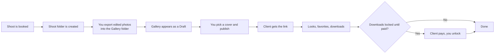
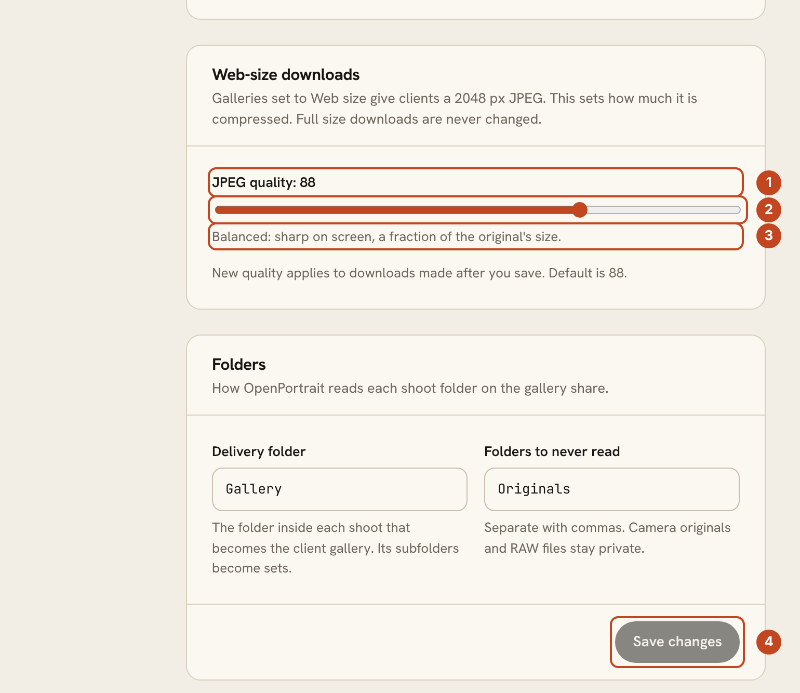

# Client galleries: a step-by-step guide

A gallery is a folder of finished photos that your client opens in a web page: they look, favorite, and download. This page follows one gallery from the camera to the client and says what each choice means. For the full design, see [Galleries: design](GALLERIES.md).

## The path of a gallery

1. **Book the shoot.** OpenPortrait creates a folder for it on your gallery share, such as `2026/2026-11-14 Family - Smith Family/`, with `Gallery/` for finished photos and `Originals/RAW/` for camera files.
2. **Export into `Gallery/`.** From Lightroom, Aftershoot or any editor, export JPEGs there. Each subfolder becomes a set, for example `Highlights` and `Full Gallery`. Folders starting with `_` or `.` and RAW files are never shown.
3. **Review the draft.** The gallery appears under **Galleries** when the folder has been quiet for a moment. Pick a cover photo and check the sets.
4. **Publish.** Click **Publish and email client**, choose the download options below, and send the link.
5. **After that.** Photos you add later appear straight away. Favorites arrive on the gallery's Favorites tab, and every view and download is on its Activity tab.

## Choose who can open it

| Access | Good for | Watch out for |
|---|---|---|
| **Private link** (default) | Most clients. One tap, no password | Anyone with the link can open it, so don't post it publicly |
| **Password** | Sensitive shoots | Clients must type it, and you share it separately from the link |
| **Registration** | Knowing who looked | Visitors give their email before seeing photos |

An email is asked for only when a client first favorites or downloads, never before they see the photos.

## Choose what clients can download

Set this per gallery under **Settings** on the gallery.

| Size | What the client gets | Pros | Cons |
|---|---|---|---|
| **No downloads** | View and favorite only | Full control, good for proofing | Clients may ask for files another way |
| **Web size** | A 2048 px JPEG | Small, quick to share, fine for screens and social | Not for large prints |
| **Web size and full resolution** | Both | Everything in one place | Full-size files are large; use a lock so you're paid first |

### Set the web-size quality

Open **Settings > Galleries > Web-size downloads**.

1. The current quality, from 60 to 100. The default is 88.
2. Drag the slider.
3. A plain-words description of what that quality means.
4. Click **Save changes**. New downloads use it; nothing else needs doing.

Quality only changes the web-size copy. Full-size downloads are never touched. The setting is studio-wide, not per gallery.

| Quality | Typical result | File size compared with 88 |
|---|---|---|
| 60 to 70 | Smallest files; fine detail and skin texture can soften | roughly one fifth to one third |
| 80 | Still sharp on a phone or laptop | roughly half |
| **88 (default)** | Balanced | baseline |
| 92 | Very clean, larger files | roughly one and a half times |
| 100 | Near-lossless | several times larger, rarely worth it for web copies |

The size column comes from a test image and is a rough guide; your photos will vary. Changing the quality rebuilds each web copy the next time someone downloads it, so the first downloads after a change may take a little longer.

## Decide when downloads open

Under **Download lock** (studio default in **Settings > Galleries**, changeable for each gallery when you publish):

| Mode | What happens | Pros | Cons |
|---|---|---|---|
| **Locked until paid** (default) | Clients view and favorite; downloads open after the final balance is paid | Protects payment | Clients wait for the unlock |
| **Highlights now, the rest after payment** | Sets you mark "early download" open now | Gives clients something to share while paying | You must mark the early sets |
| **Downloads open now** | No lock | Simplest | No payment protection |

While anything is locked, previews of locked photos carry your watermark, and the download dialog tells the client why and links to the invoice. When the client pays, switch the lock off on the gallery. The watermark disappears with it, and downloaded files never carry a watermark. Set the watermark under **Settings > Galleries**.

### Protected proofing

Previews that carry the watermark are also re-drawn smaller, with the marks spread irregularly across the photo instead of in an even grid. Under **Settings > Galleries > Protected proofing** pick a strength (Light 1800 px, Balanced 1400 px, Strong 1000 px, or a size of your own) and when it applies: while downloads are locked (the default), always, or never. A gallery can follow the studio default or use its own choice in its Settings tab. The before and after preview is drawn by the same code that protects real photos. Protecting previews is separate from locking downloads, so turning one off never changes the other.

This deters casual copying and lowers the quality of anything copied. It does not stop screenshots or every attempt to recreate a photo, so keep downloads locked until you are paid.

## Favorites and proofing

- Each gallery has a **Favorites** list. Add more lists with a limit, such as "Album picks (40)".
- Clients can add notes to a favorite and then **Submit to photographer**. You get an email and the list appears on the Favorites tab, with filenames you can paste into Lightroom's search.

## Zip downloads

Clients can download everything, one set, or their favorites as a zip. The zip is built as it downloads, so it works for big galleries and is split into numbered parts above 2 GB.

If your originals are kept somewhere other than the server (for example an outside storage bucket) and that storage can't be reached, the client sees a plain "please try again in a little while" message before anything downloads. It does not use up their download allowance. If the storage fails in the middle of a zip, the download stops with an error rather than finishing with missing photos, so the client knows to try again.

## Good to know

- Downloads go through the gallery's sign-in, code and payment checks every time.
- Per-client download limits are available under each gallery's settings.
- Back up your photos. A gallery is not a backup. See [Backups](install-docker.md#maintenance-commands).
