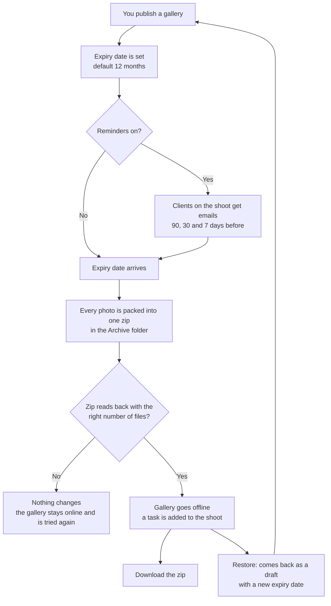
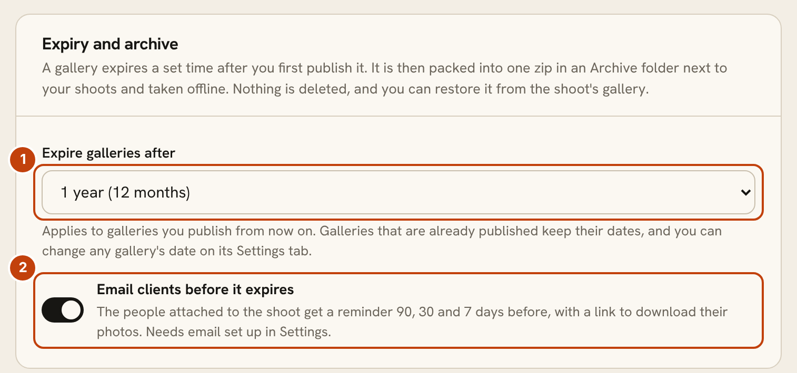
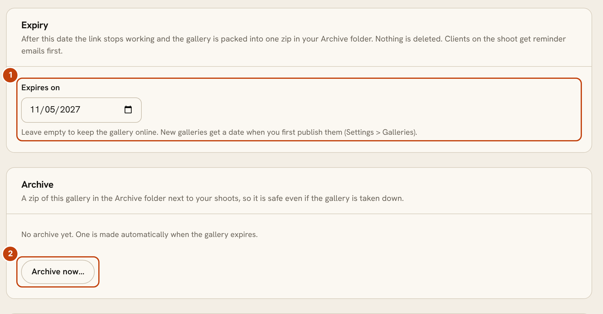
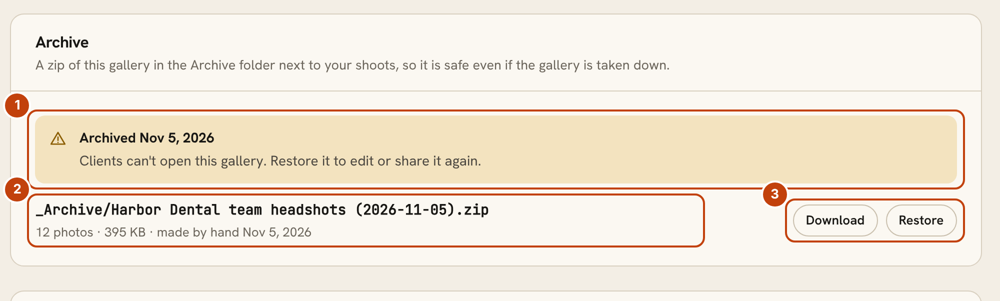

# Gallery expiry and archive

A client gallery does not have to stay online forever. OpenPortrait gives every gallery an expiry date, reminds the people on the shoot before it arrives, and then packs the gallery into one zip file and takes it offline. Nothing is deleted. You can download the zip or restore the gallery whenever you need it.

## Set the studio default

Open **Settings > Galleries** and find **Expiry and archive**.

1. **Expire galleries after.** Choose Never, 1, 3, 6, 12 (the default), 18, 24 or 36 months. The clock starts when you first publish a gallery. It applies to galleries you publish from now on. Galleries that are already published keep their dates.
2. **Email clients before it expires.** On by default. The people attached to the shoot get a reminder 90, 30 and 7 days before, with a link to the gallery so they can download their photos. It needs email set up in Settings.

| Choice | Good | Watch out for |
|---|---|---|
| A short expiry (3 to 6 months) | Keeps your disk tidy and nudges clients to download | Clients who forget will find the gallery gone and ask you to restore it |
| 12 months (default) | A year is enough for most clients to download and order | Old shoots stay online until the date arrives |
| Never | Galleries stay up until you take them down | Nothing frees space, and old links stay open forever |
| Reminders off | No emails go out | Clients get no warning |

Archiving does not free disk space by itself. The zip sits in the Archive folder next to your shoot folders, and your original photos stay where they are. The zip is stored without compression, so it is about the size of the photos in it.

## Change one gallery

Open the gallery, choose **Settings**, and find the **Expiry** and **Archive** cards.

1. **Expires on.** Change the date, or clear it to keep this gallery online. Extending the date is how you give a client more time.
2. **Archive now.** Packs the gallery into a zip straight away and takes it offline, without waiting for the date. You are asked to confirm first.

## What happens when it expires

About once an hour OpenPortrait checks for galleries past their date. For each one it:

1. Reads every photo of the gallery into one zip in the **Archive** folder, which sits beside your shoot folders. If some originals are in remote storage, they are read from there. If the storage can't be reached, the gallery waits and is tried again.
2. Opens the finished zip and counts the files. If the count is wrong, the zip is thrown away and the gallery stays online.
3. Marks the gallery archived. Clients who open the link see that it has expired.
4. Adds a task to the shoot saying the gallery was archived and how many files are in the zip.

Your original photos are never deleted by this. The zip is a copy.

## Download or restore

1. **The archived notice.** Clients can't open the gallery until you restore it.
2. **The zip.** Its name, photo count, size, and whether it was made when the gallery expired or by hand.
3. **Download and Restore.** Download saves the zip to your computer. Restore unpacks any photos that are missing from the shoot folder and leaves the ones already there alone.

A restored gallery comes back as a **draft** with a fresh expiry date. It is not live until you publish it again. Reminder emails start again from the new date.

## Good to know

- **Back up the Archive folder.** If the zip is the only copy of a shoot, losing it loses the shoot. Include the Archive folder in your regular backups.
- **Favorites may not come back.** See Known issues below.
- **Reminders go to the people on the shoot.** That is the main contact and anyone added to the shoot. Visitors who only registered to view a gallery are not emailed. A gallery with no shoot, or whose people have no email address, sends no reminders.
- **An empty gallery can't be archived.**
- **Archive folder.** It starts with an underscore, so OpenPortrait never reads it as a gallery.

## Known issues

**Restored photos can lose their favorites and download counts.** OpenPortrait forgets photos that have been missing from the share for more than 30 days. If a gallery's photos were missing for longer than that before you restore it, the restore unpacks them from the zip and they are added again as new photos. Anything tied to the old photos, such as clients' favorite picks and per-photo download counts, may not carry over.

- Restoring within 30 days of the photos going missing keeps them.
- This matters mainly when the photos have been removed from your share after archiving. Photos that stayed in the shoot folder are untouched by a restore.
- If it matters, ask the client to choose their favorites again after the restore.
