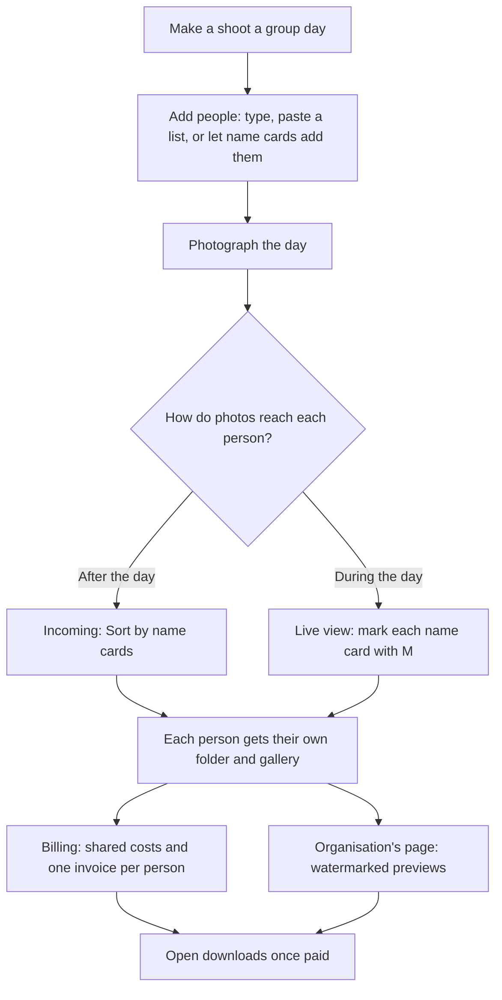
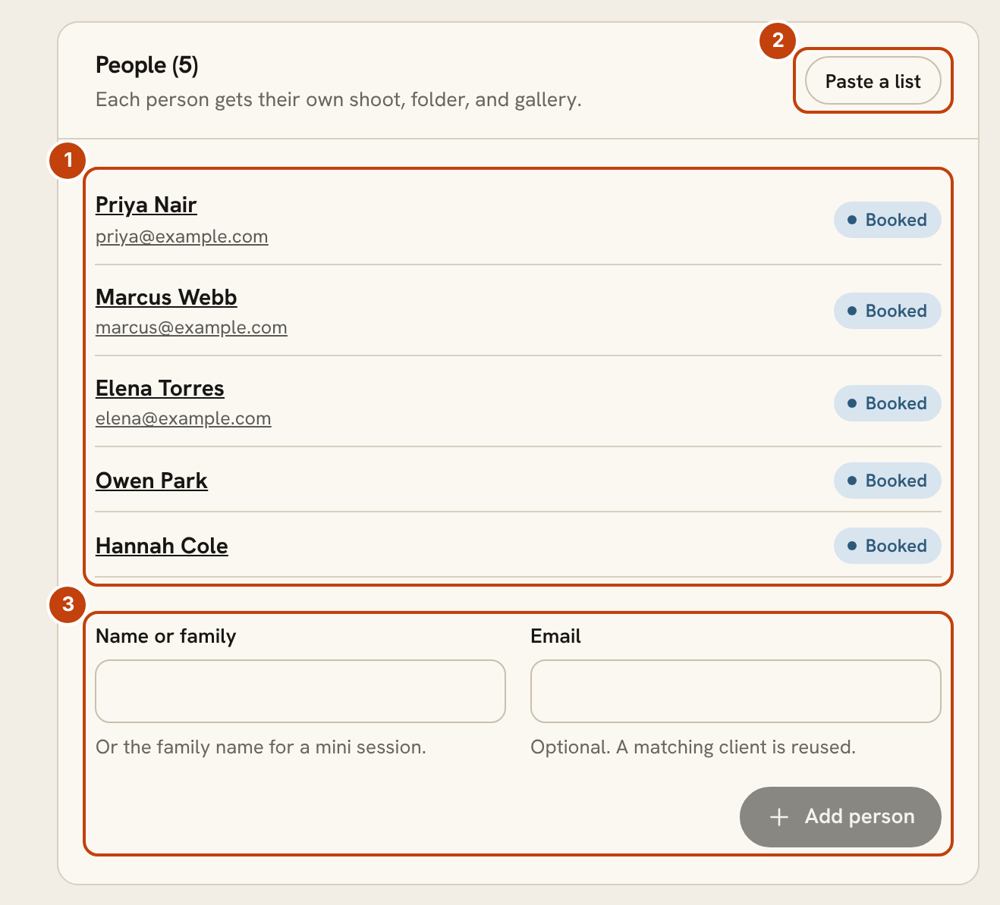
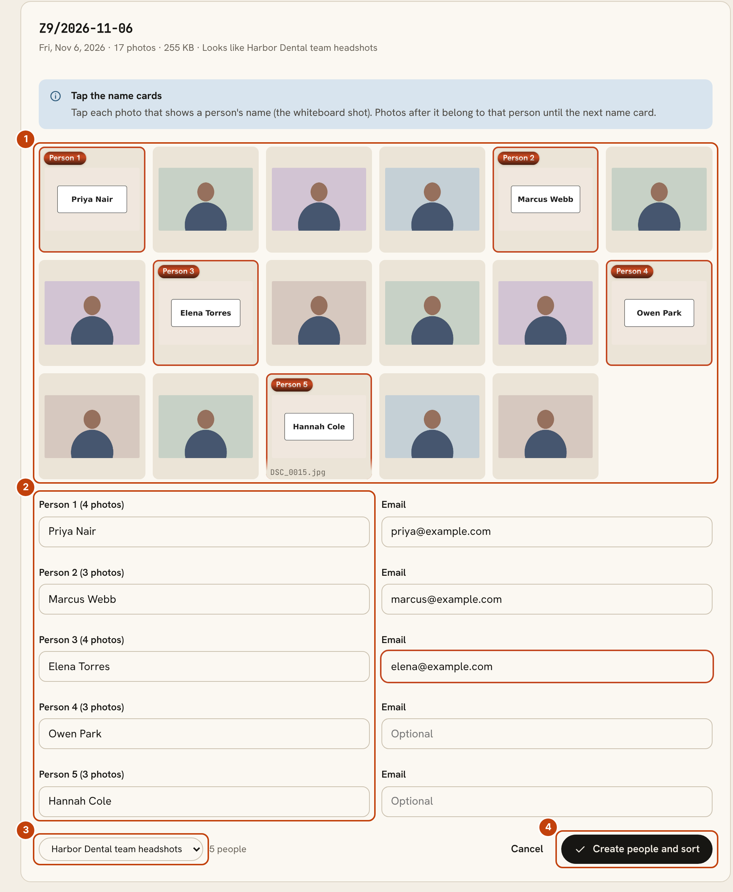
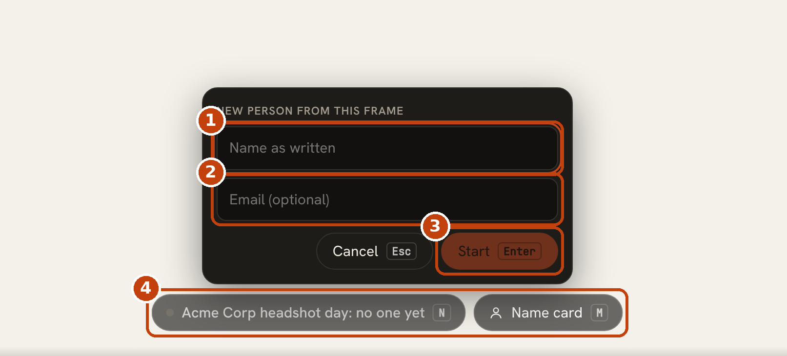
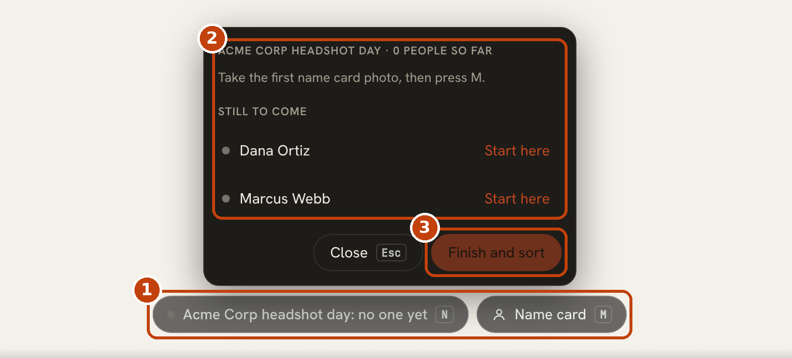
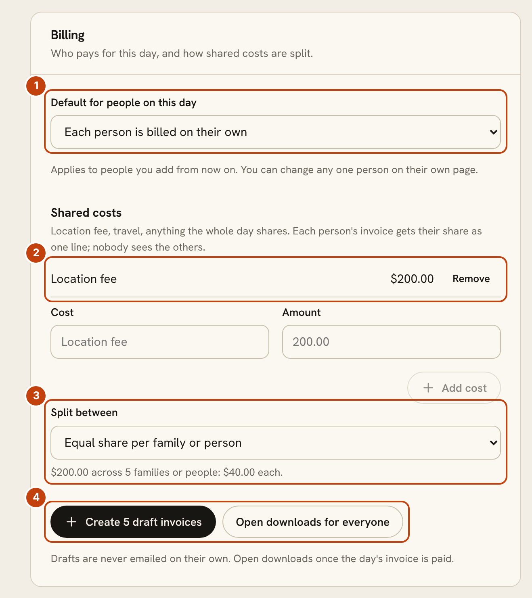
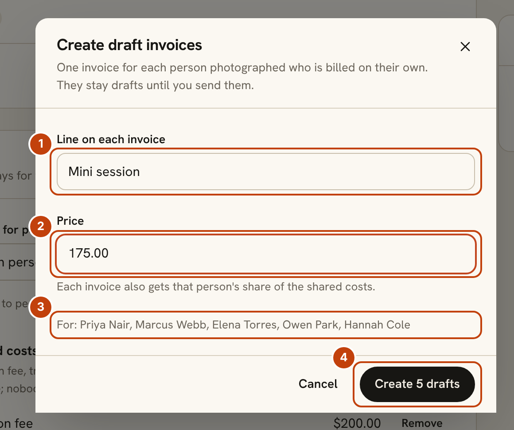
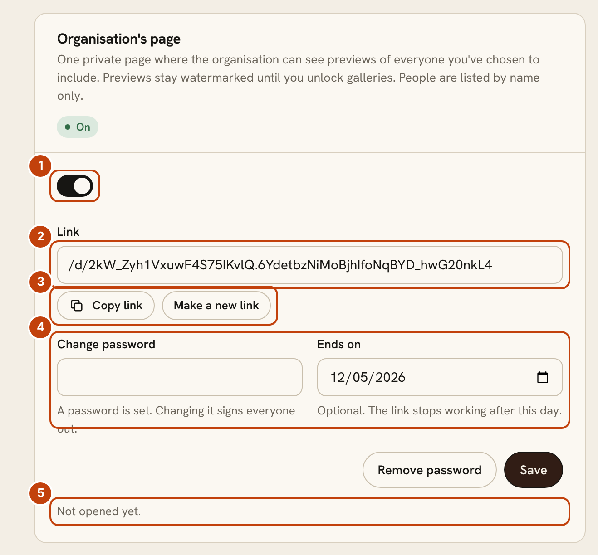
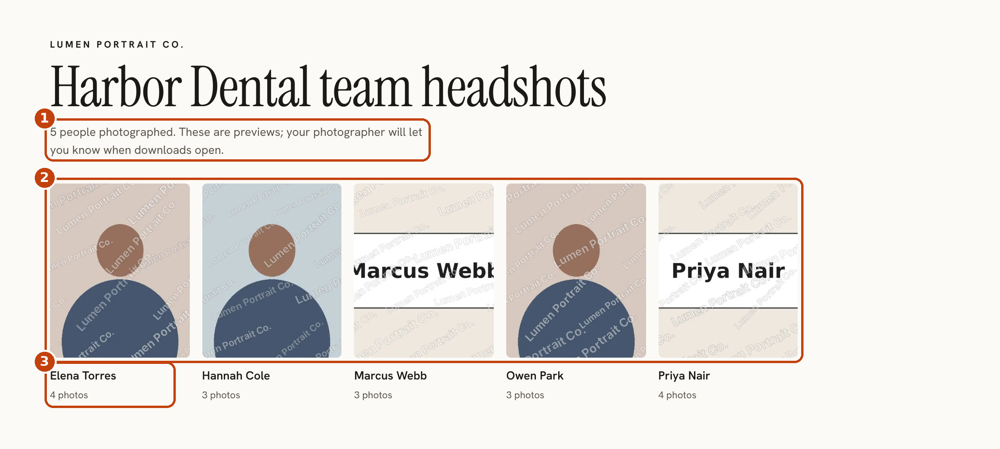

# Group days: photograph a whole team in one day

A group day is one shoot that holds many people. Think office headshots, a school picture day or a mini-session day. Each person gets their own small shoot, folder, gallery and invoice, and you keep it all together under the day. It is free and part of every install.

## How a group day flows

## Start a group day

1. Open the shoot, then in the **Group day** panel choose **Make this a group day**.
2. Add the people. Choose **Paste a list** and paste one person per line as `Name, email@example.com` (the email is optional), or use **Name or family** and **Email** to add one at a time. A client with a matching email is reused, so nobody is entered twice.
3. Photograph the day. You do not have to know everyone first. People can be added from their name cards later.

1. **The people on this day.** Each person has their own shoot with a status chip. Choose a name to open their page.
2. **Paste a list.** Add many people at once from a spreadsheet column or an email.
3. **Add one person.** For a mini session, use the family name and set the headcount on the person's page.

On a person's own page, the **Group day** panel lets you switch **Show on the organisation's page** on or off, set **People in this shoot** (a family of four is 4) and choose how that person is **Billed**.

## Sort photos by name cards

The easiest way to tell a big day apart is to photograph a name card before each person: a whiteboard, a sign or a piece of paper with their name. Photos that follow a name card belong to that person until the next card.

### After the day, from Incoming

Open **Incoming**, find the camera folder and choose **Sort by name cards**.

1. **Tap each photo that shows a name card.** Photos are shown in the order they were taken. Each card is numbered Person 1, Person 2 and so on, and the photos after it count toward that person.
2. **Type each name as written.** Add an email if you have one so the person can get their gallery later. The heading shows how many photos each person has.
3. **Choose the group day** the people belong to.
4. **Create people and sort.** Each person gets a shoot, a folder and their photos in it. Photos before the first name card stay in Incoming.

Nothing moves until you choose **Create people and sort**, and cancelling leaves every photo where it was.

### During the day, from the live view

If you shoot tethered, open **Tethering**, choose the **Incoming** source and pick your day under **Shooting a group day?**. The live view then shows two controls over the photos:

- **Name card (M).** Press **M** on a frame that shows a name card. A small sheet asks for the name.
- **People (N).** Press **N** to open the list of people so far, with a frame count for each.

1. **Name as written.** Type the name on the card.
2. **Email.** Optional. Add it so the person can get their gallery later.
3. **Start.** Press **Enter**. Every photo from here belongs to this person until the next name card. **Esc** cancels.
4. **The two controls.** The first shows who you are on now and how many frames they have. The second marks the current frame as a name card.

1. **People (N) and Name card (M).** The same controls, always within reach.
2. **The list.** Everyone marked so far with their frame count, and **Still to come**, which lists people already on the day. Choose **Start here** next to someone to make the current frame their name card. A mistaken card is removed with the **x** beside it.
3. **Finish and sort.** Sorts the photos the same way as **Sort by name cards** in Incoming. Photos before the first card stay in Incoming.

## Billing: shared costs and one invoice per person

The **Billing** panel on the group day sets who pays and how shared costs are split.

1. **Default for people on this day.** Either **Each person is billed on their own**, or **One invoice to the organisation covers everyone**. It applies to people you add from now on, and you can change any one person on their own page.
2. **Shared costs.** Location fee, travel, anything the whole day shares. Each person's invoice gets their share as one line, and nobody sees what the others pay.
3. **Split between.** **Equal share per family or person**, or **By number of people in each** (uses the headcount on each person's page). A line under the menu shows the result, such as "$200.00 across 5 families or people: $40.00 each".
4. **Create draft invoices** and **Open downloads for everyone.** Drafts are never emailed on their own. You send them when you are ready.

### Create the invoices

Choose **Create draft invoices** to make one invoice for each person photographed who is billed on their own.

1. **Line on each invoice.** The description, such as "Mini session".
2. **Price.** The price per person. Each invoice also gets that person's share of the shared costs.
3. **Who it is for.** Everyone photographed who does not have an invoice yet.
4. **Create drafts.**

When one invoice to the organisation covers everyone, the **Billing** panel shows a recount for the day's invoice. It sets the quantity on the invoice to the number of people photographed so far. Create that invoice from the **Quotes and invoices** panel with a line priced per person.

Open downloads once the invoice is paid. **Open downloads for everyone** lifts the download lock on every person's gallery in one step.

## The organisation's page

Give the organisation (the company, school or team) one private page where they can see previews of everyone, without handing out each person's gallery link.

1. **Share this page.** Switch it on to create the link. Switch it off and the link stops working.
2. **Link.** The address to send to the organisation.
3. **Copy link** and **Make a new link.** A new link retires the old one straight away.
4. **Password and Ends on.** Both are optional. A password needs at least six characters, and changing it signs everyone out. After the end date, the link stops working.
5. **Views.** Shows how many times the page was opened and when it was last opened.

What the organisation sees:

1. **The header.** The studio name, the day and how many people have been photographed. It says these are previews and that the photographer will say when downloads open.
2. **One tile per person.** Previews are watermarked until you unlock downloads. A gallery appears as soon as you publish it.
3. **Names and counts only.** People are listed by name and photo count. There is no contact information.

Leave a person off the page by switching **Show on the organisation's page** off on their own page. They are still part of the day and still get their own gallery.

## Good to know

- A person's gallery is an ordinary gallery. Everything in the [client galleries guide](galleries-guide.md) applies to it, including protected proofing.
- The organisation's page never shows email addresses, invoices or downloads.
- Photos not under a name card stay in Incoming. Nothing is deleted.
