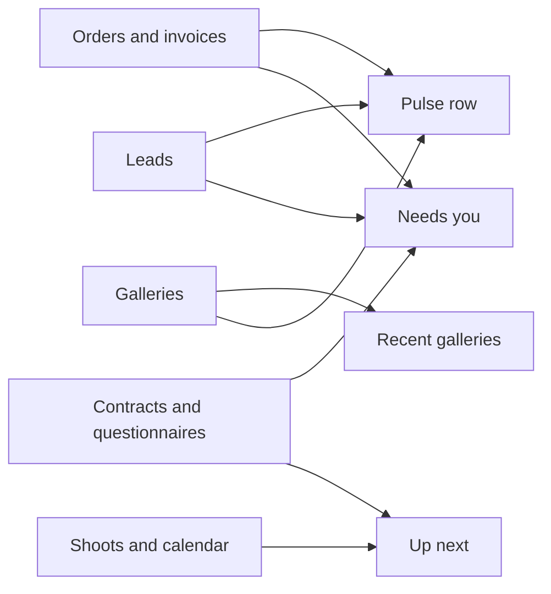
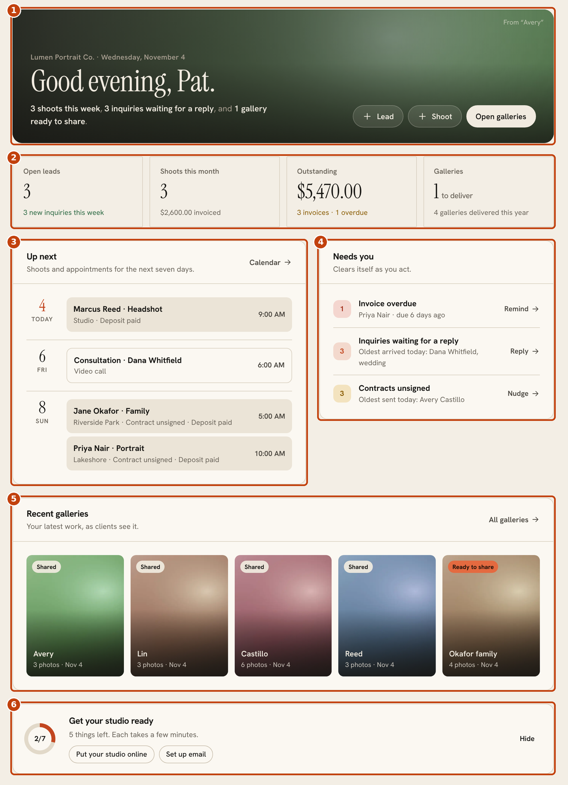
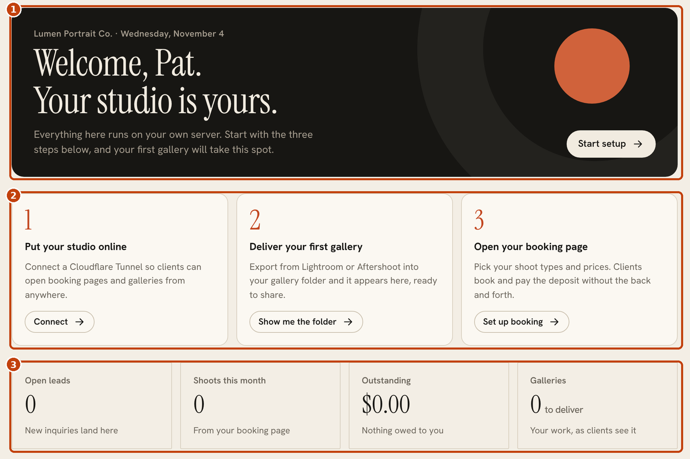
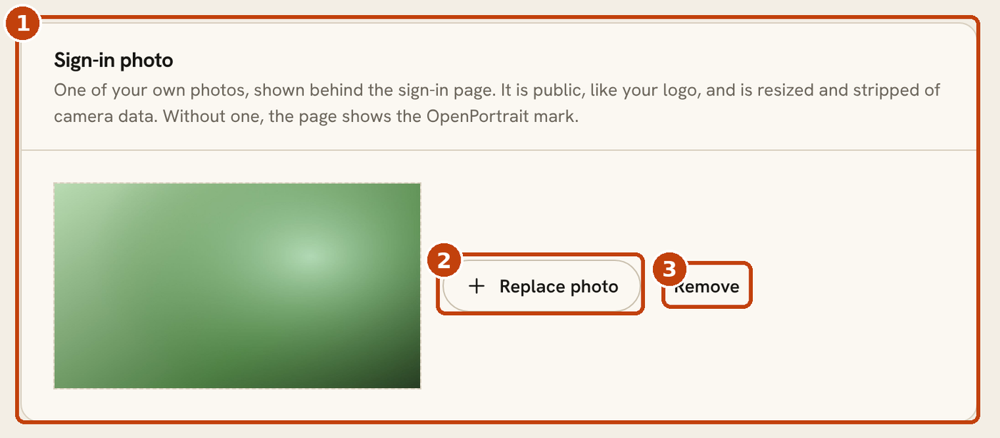

# The Home screen

Home is the first thing you see after signing in. It answers three questions: what is happening this week, what needs me, and what did I deliver lately. It is free and needs no setup. Everything on it is read from your own studio data.

## Where each part comes from

## A working studio

1. **The header.** A greeting with a one-line summary of the week, quick actions (**Lead**, **Shoot**, **Open galleries**) and the cover of your latest gallery behind it.
2. **The pulse row.** Open leads and new inquiries this week, shoots this month and what you have invoiced, money outstanding with the number overdue, and galleries waiting to be delivered.
3. **Up next.** Shoots and appointments for the next seven days. Each shoot shows whether its contract is signed, the deposit is paid and its questionnaire is done.
4. **Needs you.** What is waiting on you: inquiries to answer, overdue invoices, unsigned contracts, questionnaires that are out, and galleries ready to share. Each row has a button to act on it, such as **Remind**, **Reply** or **Nudge**. A row disappears when you've dealt with it.
5. **Recent galleries.** Your latest work as clients see it. A gallery marked **Ready to share** hasn't been sent yet.
6. **Get your studio ready.** A short setup checklist. It collapses once the first steps are done, and **Hide** removes it.

## A brand-new studio

Until you have a gallery, Home shows a three-step walkthrough in place of the header.

1. **Welcome.** **Start setup** begins the first step.
2. **Three steps:** put your studio online ([Cloudflare Tunnel](cloudflare-tunnel.md)), deliver your first gallery, and open your booking page ([booking](booking.md)).
3. **The pulse row** starts at zero and fills in as you work.

Your first gallery takes the place of the walkthrough as soon as one exists.

## Show your own photo on the sign-in page

Under **Settings > Studio details > Sign-in photo** you can show one of your own photos behind the sign-in page. Without one, the page shows the OpenPortrait mark.

1. **Sign-in photo** shows the current photo. It is public, like your logo, so pick one you are happy for anyone to see.
2. **Replace photo** uploads a new one. It is resized to 1800 px and stripped of camera data.
3. **Remove** goes back to the default.

The sign-in page headline becomes your studio name. Free, no extra cost.
