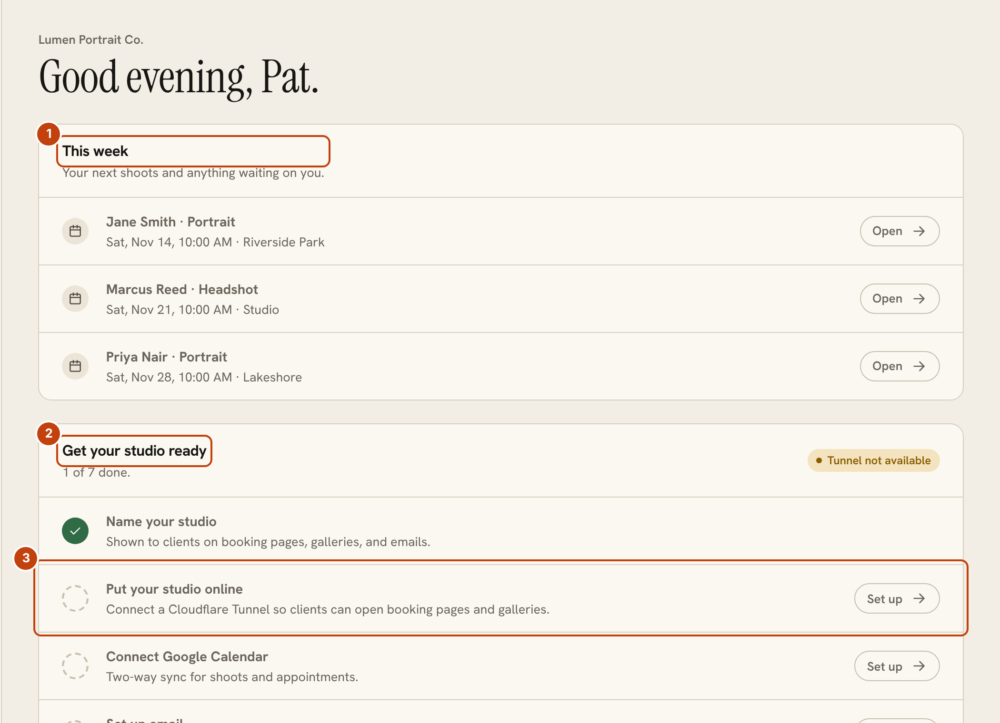
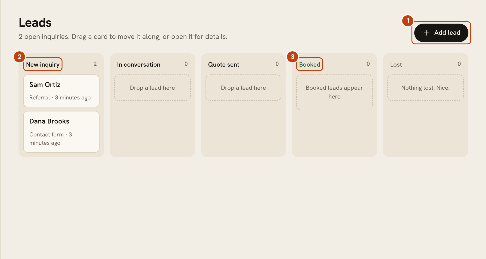

# OpenPortrait

OpenPortrait is a self-hosted studio CRM for photographers. It runs as one Docker container on your own hardware, such as an Unraid server, and keeps your clients, shoots, galleries, quotes, contracts and photos on storage you control.

New here? Open [Start here](start-here.md) for a picture of every setup option, then [install](install-docker.md), then [reach your studio from the internet](cloudflare-tunnel.md) if you want clients and staff to get in from outside your network.

Pages in this guide cover the open-source app. Pro add-on features are documented separately.

## Find your way around

**Home** shows your next shoots and a short setup checklist. Each row of the checklist opens the right settings page.

1. **This week** lists your next shoots and anything waiting on you.
2. **Get your studio ready** is the setup checklist. Rows tick off as you finish them.
3. **Set up** jumps straight to the page for that step, such as putting your studio online.

**Leads** is a board of inquiries. Drag a card to the next stage as the conversation moves on.

1. **Add lead** creates an inquiry by hand. Contact forms and booking pages add them for you.
2. **New inquiry** is where every lead starts.
3. **Booked** collects the leads that became shoots.
