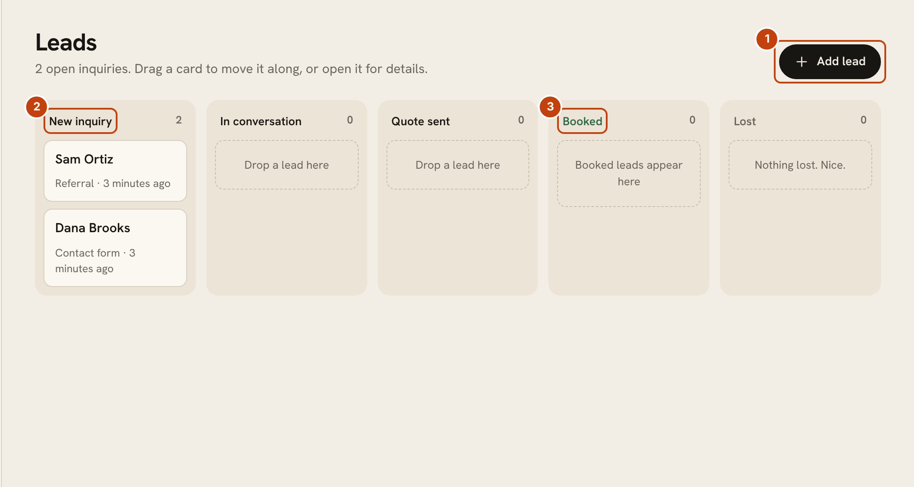

Documentation

# Your studio, on your own server

OpenPortrait is a self-hosted studio CRM for photographers. It runs as one Docker container on hardware you own, and your clients, shoots, galleries, contracts and photos stay on storage you control.

<a class="op-btn" href="start-here/">Start here</a>
<a class="op-btn op-btn--ghost" href="install-docker/">Install</a>

<a class="op-step" href="start-here/"><b>Choose your setup</b>One picture of every option, with what each costs you.</a>
<a class="op-step" href="install-docker/"><b>Install</b>Unraid, Docker Compose or a single docker run.</a>
<a class="op-step" href="cloudflare-tunnel/"><b>Open it to clients</b>Reach the studio from outside your network without opening a port.</a>

Pages in this guide cover the open-source app. Pro add-on features are documented separately.

## Browse by job

<a class="op-card" href="home/"><svg viewBox="0 0 24 24"><path d="M4 19.5v-15A2.500 2.500 0 0 1 6.500 2H20v20H6.500a2.500 2.500 0 0 1 0-5H20"/></svg>Run the studio day to dayHome screen, leads, tasks, households and the calendar.</a>
<a class="op-card" href="booking/"><svg viewBox="0 0 24 24"><rect x="3" y="4" width="18" height="18" rx="2"/><path d="M16 2v4M8 2v4M3 10h18"/></svg>Take bookingsEmail, the inquiry form, booking pages and questionnaires.</a>
<a class="op-card" href="contracts/"><svg viewBox="0 0 24 24"><path d="M14 2H6a2 2 0 0 0-2 2v16a2 2 0 0 0 2 2h12a2 2 0 0 0 2-2V8z"/><path d="M14 2v6h6M8 13h8M8 17h5"/></svg>Get signed and paidContracts, e-signatures, quotes, invoices and coupons.</a>
<a class="op-card" href="galleries-guide/"><svg viewBox="0 0 24 24"><rect x="3" y="3" width="18" height="18" rx="2"/><circle cx="9" cy="9" r="2"/><path d="m21 15-3.100-3.100a2 2 0 0 0-2.800 0L6 21"/></svg>Deliver galleriesClient galleries step by step, proofing, expiry and archive.</a>
<a class="op-card" href="camera-upload/"><svg viewBox="0 0 24 24"><path d="M14.500 4h-5L7 7H4a2 2 0 0 0-2 2v9a2 2 0 0 0 2 2h16a2 2 0 0 0 2-2V9a2 2 0 0 0-2-2h-3z"/><circle cx="12" cy="13" r="3"/></svg>Send photos from the cameraCamera upload at the studio or on location, and tethering.</a>
<a class="op-card" href="group-days/"><svg viewBox="0 0 24 24"><path d="M16 21v-2a4 4 0 0 0-4-4H6a4 4 0 0 0-4 4v2"/><circle cx="9" cy="7" r="4"/><path d="M22 21v-2a4 4 0 0 0-3-3.870M16 3.130a4 4 0 0 1 0 7.750"/></svg>Photograph a whole teamGroup days: sign-up, the shooting list and billing.</a>
<a class="op-card" href="website/"><svg viewBox="0 0 24 24"><circle cx="12" cy="12" r="10"/><path d="M2 12h20M12 2a15.300 15.300 0 0 1 4 10 15.300 15.300 0 0 1-4 10 15.300 15.300 0 0 1-4-10 15.300 15.300 0 0 1 4-10z"/></svg>Build your websitePages, templates and your own domain.</a>
<a class="op-card" href="ai-access/"><svg viewBox="0 0 24 24"><path d="M12 8V4H8"/><rect x="4" y="8" width="16" height="12" rx="2"/><path d="M2 14h2M20 14h2M15 13v2M9 13v2"/></svg>Connect your AILet an assistant read and act in the studio, with approvals.</a>
<a class="op-card" href="import/"><svg viewBox="0 0 24 24"><path d="M21 15v4a2 2 0 0 1-2 2H5a2 2 0 0 1-2-2v-4M7 10l5 5 5-5M12 15V3"/></svg>Bring your data overImport clients, shoots and orders from a spreadsheet.</a>

## Find your way around

**Home** is your daily overview. See [The Home screen](home.md).

**Leads** is a board of inquiries. Drag a card to the next stage as the conversation moves on.

1. **Add lead** creates an inquiry by hand. Contact forms and booking pages add them for you.
2. **New inquiry** is where every lead starts.
3. **Booked** collects the leads that became shoots.
