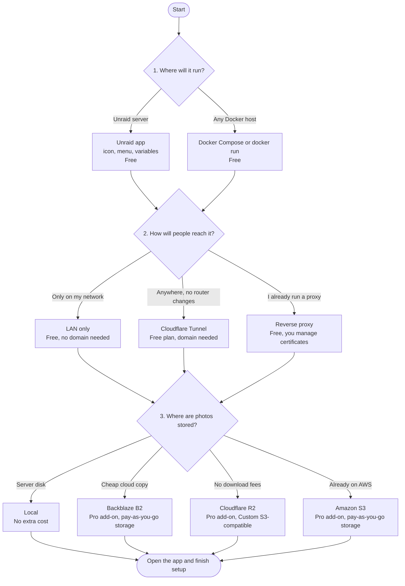

# Start here: choose your setup

OpenPortrait is one container that you run yourself. Your clients, contracts, galleries and photos stay on hardware and accounts you control. This page shows every way to set it up, what each one costs, and where to go next. Follow the arrows from top to bottom and write down your three choices: **where it runs**, **how people reach it**, and **where photos are stored**.

## The whole picture

Everything above the storage step is free and open source. Cloud storage for originals is the only part that needs the paid Pro add-on, plus whatever your storage provider charges you.

## Choice 1: where it runs

| Option | Best for | Pros | Cons | Cost |
|---|---|---|---|---|
| **Unraid app** | Anyone with an Unraid server | Fill-in form for every setting, app icon, one-click updates | Needs an Unraid server | Free |
| **Docker Compose** | Linux, Synology, TrueNAS, Docker Desktop | Hardened settings come ready-made, easy to copy and back up | You edit a text file | Free |
| **`docker run`** | Quick tests, custom setups | One command | You must keep the safety flags yourself | Free |

Next step: [Install with Docker, Compose or Unraid](install-docker.md). It takes about ten minutes and ends at the first-run screen.

## Choice 2: how people reach it

You and your staff can always use the app on your home network. Clients need a public address for galleries, booking pages and contracts.

| Option | Pros | Cons | Cost |
|---|---|---|---|
| **LAN only** | Nothing is exposed to the internet, simplest and most private | Clients can't open galleries, book or sign from outside your network | Free |
| **Cloudflare Tunnel** (built in) | No port forwarding, your home IP stays hidden, HTTPS included | Needs a domain on Cloudflare, and the studio depends on Cloudflare being up | Free plan, no card needed. A domain costs roughly $10 to $15 a year from your registrar |
| **Your own reverse proxy** | Full control, no third party | You handle certificates, port forwarding and security, and must set `TRUSTED_PROXIES` | Free, plus a domain |

Next step for most people: [Internet access with Cloudflare Tunnel](cloudflare-tunnel.md). Camera uploads over SFTP don't travel through the tunnel; see [Camera upload](camera-upload.md).

## Choice 3: where photos are stored

| Option | Pros | Cons | Cost |
|---|---|---|---|
| **Local disk or share** (default) | Fast, private, no monthly bill, works offline | One place to lose them, so back them up | Free |
| **Backblaze B2** | Low-cost storage, good for originals you rarely open | Download fees may apply beyond a free allowance | Pro add-on, plus storage billed by Backblaze |
| **Cloudflare R2** | No fees for downloading your files, works through the "Custom S3-compatible" choice | Storage per GB costs more than B2 | Pro add-on, plus storage billed by Cloudflare |
| **Amazon S3** | Familiar, many regions | Highest download fees of the three, more settings to understand | Pro add-on, plus storage billed by AWS |

Provider prices change. Check the provider's current price page before you commit. Whatever you choose, keep a second copy of your photos: see [Backups](install-docker.md#maintenance-commands).

## What you get without paying for anything

- **Studio:** clients, households, leads, shoots with a day-of timeline, tasks, and a calendar with Google Calendar sync.
- **Selling:** booking pages, quotes, invoices, coupons, client credit, PayPal payments, contracts with e-signatures, questionnaires.
- **Photos:** client galleries with favorites, downloads and download limits, camera upload by SFTP or FTP, and tethering.
- **Safety:** two-step sign-in, nightly backups, hardened container.
- **Reach:** a studio website builder and AI access so an assistant can read your studio data.
- **Yours:** AGPL open source, no per-gallery fees, and you can export your data at any time.

## Which path should I pick?

- **"I have an Unraid box and want it working today."** Unraid app, then Cloudflare Tunnel, local photos.
- **"I just want to try it."** Docker Compose on your laptop, LAN only, local photos. Nothing leaves your machine.
- **"My photo share is small and I want an offsite copy."** Add cloud storage later; you can start local and move on when you need to.
